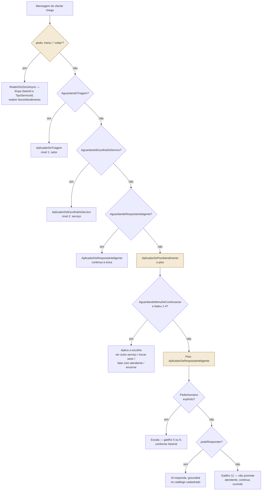

# FLUXO DE AUTOMAÇÃO — MENSAGENS AUTOMÁTICAS E IA

> **Status:** implementado e verificado (Fase 2E — "piso da IA"; Fase 2G — IA
> só escala por pedido explícito).
> **Última atualização:** 2026-08-18
>
> Documento único e definitivo do **comportamento** de automação: o que dispara,
> em que ordem, e por que cada decisão é assim. [MODELO-DADOS.md](MODELO-DADOS.md)
> descreve as colunas; este documento descreve o que elas fazem quando o cliente
> escreve. Onde os dois divergirem, este vale para comportamento e
> MODELO-DADOS.md vale para schema.

---

## 1. A regra que organiza tudo

**O cliente nunca termina uma mensagem sem resposta — não importa em que ponto
da conversa ela chegou.** Não é aspiração: é o requisito que reorganizou este
módulo inteiro em 2026-08-17, depois de um teste ao vivo mostrar conversas
reais caindo em silêncio. Todo caminho deste documento termina numa mensagem ao
cliente, nem que seja "vou te encaminhar para um atendente".

Três mecanismos garantem isso, em camadas, do mais específico para o mais geral:

1. **Mensagem automática** — regra de cadastro (`MensagemAutomatica`), disparada
   por um `GatilhoDeMensagem` específico. Rápida, previsível, de graça.
2. **Resposta Inteligente (IA)** — quando nenhuma regra bate, tenta responder
   com o que está cadastrado no catálogo antes de admitir que não sabe.
3. **`AplicadorDePosAtendimento`** — o piso final. Roda sempre que nenhuma das
   flags de fluxo está ligada, e é ele quem garante que a camada 2 seja
   tentada mesmo quando a conversa "já acabou" do ponto de vista estruturado.

---

## 2. Os três tipos de mensagem gerada pelo sistema

| | Dispara sozinho? | Quem assina | Chega ao cliente? | Onde mora |
| --- | --- | --- | --- | --- |
| **Mensagem automática** | sim | o sistema (regra de cadastro) | sim | `MensagemAutomatica`, `AutorTipo.Sistema` + `EhAutomatica=true` |
| **Resposta da IA** | sim | o sistema (modelo de linguagem) | sim | `AutorTipo.Sistema` + `EhAutomatica=true` + `GeradaPorIa=true` |
| **Anotação de sistema** | sim | ninguém — é registro | nunca | `AutorTipo.Sistema` + `EhAutomatica=false` |

As duas primeiras são **indistinguíveis para o cliente** — chegam como mensagem
normal no WhatsApp. A interface do painel é quem rotula "Automática" ou "IA"
para o atendente, usando `GeradaPorIa` para diferenciar. A terceira nunca sai
do painel: é o "Triagem automática encaminhou ao setor X" que dá contexto ao
próximo atendente sem virar mensagem ao cliente.

---

## 3. Os 11 gatilhos

`GatilhoDeMensagem` é **enum, não tabela** — cada valor corresponde a um ponto
de código que precisa existir para disparar. Gatilho novo exige código novo;
**texto** de cada mensagem e **qual etapa dispara** (quando aplicável)
continuam sendo cadastro puro, editável em Configurações → Mensagens
automáticas, sem release.

| # | Gatilho | Quando dispara | Quem provoca |
| --- | --- | --- | --- |
| 1 | `NovoAtendimento` | Conversa aberta sem setor definido — é a mensagem de boas-vindas com o menu de triagem | `ConversaService.CriarAsync`, `AplicadorDePosAtendimento` (ao reabrir por "menu") |
| 2 | `EtapaAlterada` | Conversa entra na etapa marcada como alvo. **Exige** `EtapaAlvoId` preenchido | `ConversaService.MoverAsync` |
| 3 | `PrazoProximoVencimento` | `agora ≥ PrazoAlertaEm`, ainda dentro do prazo | Varredura periódica |
| 4 | `PrazoVencido` | `agora > PrazoLimite` | Varredura periódica |
| 5 | `TriagemSemCorrespondencia` | Resposta ao menu de setor não bate com nenhuma opção — ou o cliente pediu atendente **antes** de ter setor definido | `AplicadorDeTriagem`, `AplicadorDeRespostaInteligente.EscalarAsync` |
| 6 | `TriagemComCorrespondencia` | O setor foi reconhecido e existe ao menos 1 `TipoServico` vinculado a ele — pergunta qual serviço, com `{MenuServicos}` | `AplicadorDeTriagem`, `AplicadorDePosAtendimento` (opção "ver outro serviço"/"trocar de setor") |
| 7 | `ServicoEscolhido` | O cliente escolheu o serviço no menu de 2º nível — confirma com `{DocumentosNecessarios}` e `{PrazoServico}` | `AplicadorDeEscolhaDeServico` |
| 8 | `MenuDeContinuacao` | O atendimento estruturado terminou (checklist entregue) — oferece continuar, trocar de setor, falar com atendente ou encerrar | `AplicadorDeEscolhaDeServico`, logo após o gatilho 7 |
| 9 | `PedidoDeAtendente` | Encaminha para atendente **no meio ou depois** do atendimento (setor já definido) — texto diferente do gatilho 5 de propósito, ver §8 | `AplicadorDeRespostaInteligente.EscalarAsync`, `AplicadorDePosAtendimento` (opção "falar com atendente") |
| 10 | `Despedida` | O cliente escolheu encerrar pelo menu de continuação — envia a despedida **e fecha a conversa de verdade** (`Status = Encerrada`), ver §9 | `AplicadorDePosAtendimento` |
| 11 | `RespostaSemCorrespondencia` | A IA não encontrou, no catálogo cadastrado, como responder — e o cliente **não** pediu atendente. Nunca promete atendente; convida a pedir um se quiser, ver §8 | `AplicadorDeRespostaInteligente` |

Os gatilhos 5, 6, 7, 8, 9, 10 e 11 são texto que o **cliente do cartório lê** —
por isso nenhum deles é constante fixa em C#: virariam a única mensagem do
sistema que o cartório parceiro não poderia reescrever sozinho pela tela.

`DisparadorDeMensagemAutomatica.EnfileirarAsync` não falha quando não há regra
cadastrada para um gatilho — devolve lista vazia em silêncio. É o cartório parceiro
desligando aquele aviso pela tela (`Ativo=false`), não um erro.

---

## 4. A máquina de estado: as flags `Aguardando*`

Cada flag em `Conversa` significa **"a próxima mensagem do cliente é resposta
a X"**. Todas seguem a mesma disciplina: duram **uma mensagem só**. Acertou ou
não a opção, a flag sai — repetir o menu até o cliente adivinhar prende quem
escreveu "bom dia" num loop de robô, e é o motivo pelo qual gente desiste de
atendimento por WhatsApp.

| Flag | Ligada por | Lida por | Sempre desliga quando |
| --- | --- | --- | --- |
| `AguardandoTriagem` | `NovoAtendimento`, reabertura por "menu" | `AplicadorDeTriagem` | A próxima mensagem do cliente chega, corresponda ou não |
| `AguardandoEscolhaDeServico` | `AplicadorDeTriagem`, quando o setor tem ≥1 serviço vinculado | `AplicadorDeEscolhaDeServico` | Idem |
| `AguardandoRespostaInteligente` | Qualquer resposta da IA, com sucesso ou sem (`RespostaSemCorrespondencia`) | `AplicadorDeRespostaInteligente` (chamado direto, fora do `AplicadorDePosAtendimento`) | A IA escala — **só por pedido explícito**, desde 2026-08-18 — ou o cliente pede "menu" |
| `AguardandoMenuDeContinuacao` | `ServicoEscolhido`, logo após o checklist | `AplicadorDePosAtendimento` | A próxima mensagem do cliente chega, corresponda ou não a uma das 4 opções |
| `TentativasRespostaInteligente` | Incrementado a cada resposta **bem-sucedida** da IA | — | Zerado ao escalar. **Não é mais lido por nenhuma decisão** (ver §8) — contador informativo |

Se um atendente rotear a conversa manualmente enquanto `AguardandoTriagem`
está ligada, a escolha da pessoa vale: a flag é limpa em silêncio, sem
mensagem ao cliente (`AplicadorDeTriagem`, guarda no topo do método).

---

## 5. O despacho: "menu" primeiro, dois níveis depois

O ponto de entrada — `MensagemService.SimularRecebimentoAsync` (painel) e
`RecebimentoDeWhatsApp.ReceberAsync` (webhook real) — roda a **mesma** cadeia,
porque duplicá-la faria as duas divergirem na primeira mudança, e a
divergência só apareceria na conversa de um cliente de verdade.

**"menu"/"voltar" (`Z`) é checado ANTES de qualquer flag — literalmente a
primeira coisa do despacho.** Não foi sempre assim: até 2026-08-18 isso só era
verificado dentro de `AplicadorDePosAtendimento`, que só roda quando nenhuma
das três flags do nível externo está ligada. Um cliente com
`AguardandoRespostaInteligente` ligada (o normal depois de qualquer troca com
a IA, inclusive sem sucesso — ver §8) digitava "menu" e a mensagem ia direto
para a IA, que não entende "menu" como comando e respondia qualquer coisa. Ver
`AplicadorDePosAtendimento.ReabrirDoZeroAsync` para o código — hoje é chamado
pelos dois pontos de entrada, antes de olhar qualquer flag.

`ReabrirDoZeroAsync` também **limpa `SetorId` e `TipoServicoId`** — segundo
achado no mesmo dia: sem isso, um cliente que já tinha setor definido e pedia
"menu" ficava com o campo preenchido mesmo depois de "recomeçar", e
`AplicadorDeTriagem` — ao ver `SetorId != null` com `AguardandoTriagem` ligada
— interpreta isso como "um atendente já assumiu manualmente" (guarda pensada
para outro cenário, ver §6) e **não faz nada**: nem responde, nem escala.
"Do zero" agora é literal.

**A segunda caixa (B/C/D) é o nível externo** — três flags específicas, cada
uma com um `Aplicador*` próprio. **`AplicadorDePosAtendimento` é o `else`** —
roda quando nenhuma das três está ligada, o que acontece em três situações
reais:

- O atendimento estruturado **terminou** (checklist entregue, menu de
  continuação já respondido ou nunca chegou a bater em nenhuma opção).
- A conversa **nunca passou pela triagem** (aberta direto pelo painel, com
  setor já definido).
- A IA **acabou de escalar** nesta mesma mensagem — não; nesse caso quem
  respondeu já foi `AplicadorDeRespostaInteligente` dentro do nível externo
  (`D`), e a próxima mensagem do cliente é que cairá aqui.

Dentro do `else`, **há um segundo nível de decisão**: a interpretação do menu
de continuação, se estiver no ar; e só então o piso. Uma mensagem que não bate
em nada do meio ainda cai para a IA **na mesma passada** — não custa um turno
extra pedindo "responda 1, 2, 3 ou 4".

---

## 6. Nível 1 — triagem por setor

1. Conversa nasce **sem setor** → dispara `NovoAtendimento`, liga
   `AguardandoTriagem`. O menu sai numerado com os setores **ativos**, na
   ordem do cadastro (`Setor.Ordem`).
2. A resposta do cliente é lida por
   [`TriagemAutomatica.InterpretarResposta`](../src/backend/CrmCartorio.Api/Modules/Atendimento/Domain/TriagemAutomatica.cs) —
   mesmo algoritmo do nível 2, ver §7 da classe:
   1. **Número da opção** (`1`, `2`...) — tentado primeiro, é o que o menu pede.
   2. **Nome exato**, normalizado (sem acento, minúsculo, sem pontuação).
   3. **Nome parcial**, nas duas direções (`"quero registro civil"` contém o
      nome; `"notas"` está contido nele), com mínimo de 3 caracteres e
      **exigindo correspondência única** — ambíguo devolve nulo, do mesmo
      jeito que não-reconhecido.
3. **Reconheceu um único setor:** grava `SetorId`, registra em
   `HistoricoEtapa` com `AtendenteId` nulo (convenção do modelo para "mudança
   automática"), deixa uma anotação interna no fio. Se o setor tiver ao menos
   1 `TipoServico` vinculado (`TipoServico.SetorId`), dispara
   `TriagemComCorrespondencia` e liga `AguardandoEscolhaDeServico` — nível 2.
4. **Não reconheceu, ou reconheceu mais de um:** cai para a Resposta
   Inteligente (§7) antes de escalar — a IA tenta resolver o que a triagem
   fixa não conseguiu antes de admitir que precisa de gente.

> **Caso conhecido, sem correção proposital** — ver
> [REQUISITOS.md §5.8](REQUISITOS.md): se um atendente assumir a conversa
> manualmente enquanto o menu de triagem ainda está no ar, e o cliente
> responder algo fora do menu, o sistema ainda dispara o encaminhamento —
> mesmo já havendo responsável. Decisão de atendimento, não de código; fica
> com o cartório parceiro.

---

## 7. Nível 2 — escolha do serviço

Mesmo algoritmo do nível 1, um degrau abaixo: dentro do setor já reconhecido,
`{MenuServicos}` lista os `TipoServico` **ativos** vinculados àquele setor
(`TipoServico.SetorId`), e a resposta é interpretada pelas mesmas três regras
(número, nome exato, nome parcial com mínimo 3 caracteres).

- **Reconheceu:** grava `TipoServicoId`, dispara `ServicoEscolhido` (confirma
  com `{DocumentosNecessarios}` e `{PrazoServico}`) e, na sequência, **também**
  dispara `MenuDeContinuacao` e liga `AguardandoMenuDeContinuacao` — o
  atendimento estruturado chegou ao fim, mas a conversa não pode terminar
  muda.
- **Não reconheceu:** cai para a Resposta Inteligente, mesma regra do nível 1.

> **Lacuna conhecida, ainda não fechada:** se um setor for cadastrado **sem
> nenhum** `TipoServico` vinculado (`SetorId` nunca preenchido em nenhum
> serviço), `AplicadorDeTriagem` reconhece o setor normalmente, mas **não**
> dispara `TriagemComCorrespondencia` nem liga nenhuma flag — a mensagem que
> escolheu aquele setor fica sem resposta por um turno (a mensagem
> *seguinte* do cliente já cai no piso normalmente, via `AplicadorDePosAtendimento`).
> Não acontece com o cadastro atual (os dois setores semeados têm serviço
> vinculado), mas é uma lacuna estrutural, não coberta pelo piso da IA da
> mesma forma que o resto do fluxo. Sinalizado para correção — ver tarefa
> aberta, não é bloqueio para uso normal do sistema hoje.

---

## 8. A Resposta Inteligente (IA)

Camada de contingência: responde **só com o que está cadastrado**, nunca
inventa. Ver também o `README` do módulo
[`RespostaInteligente`](../src/backend/CrmCartorio.Api/Modules/RespostaInteligente/README.md).

### Quando é chamada

- Nível 1 ou nível 2 não reconheceram a resposta do cliente.
- `AguardandoRespostaInteligente` está ligada (troca em andamento) — chamada
  direto do nível externo do despacho (§5, caixa `D`), sem passar pelo `else`.
- Como piso, dentro de `AplicadorDePosAtendimento`, para qualquer mensagem que
  não bateu em nada mais — incluindo "obrigada", "ok", ou qualquer texto solto
  depois que o atendimento estruturado já terminou.

### O que ela vê (`MontadorDeContexto`)

- **Catálogo:** nome, **setor** (entre parênteses) e descrição de cada
  `TipoServico` ativo. O setor entrou em 2026-08-18 — sem ele, "quais os
  serviços de notas?" não tinha como ser respondido: a lista de nomes chegava
  sem nenhuma pista de a qual setor cada um pertence, e a IA, corretamente,
  recusava adivinhar. **Não** inclui `DocumentosNecessarios` nem prazo — esses
  só aparecem nas mensagens automáticas estruturadas (`{DocumentosNecessarios}`,
  `{PrazoServico}`), não no grounding da IA.
- **Respostas rápidas ativas**, com `{NomeCartorio}` resolvido e qualquer
  outro marcador removido (não fazem sentido fora de uma conversa específica).
- **Histórico da própria troca**: mensagens do cliente (exceto a primeiríssima,
  que abriu o atendimento e nunca passou pela IA) intercaladas com as
  respostas já dadas pela IA (`GeradaPorIa=true`) — reconstruído do banco a
  cada chamada, nunca guardado em memória entre requisições.

Ela **não vê**: dado de outro cliente, conversa de outra pessoa, nem nada fora
do tenant atual.

### As regras do prompt (fixo em código, não cadastro)

Ver [`PromptDeSistema.cs`](../src/backend/CrmCartorio.Api/Modules/RespostaInteligente/Application/PromptDeSistema.cs) —
texto completo, versionado, não editável pela tela de propósito (é regra de
segurança, não redação). Resumo das sete regras:

1. Responde só com base no contexto — nunca inventa prazo, valor, documento
   ou qualquer dado ausente.
2. Deixa claro que é atendimento automático quando fizer sentido — nunca finge
   ser pessoa.
3. Nunca dá opinião jurídica nem interpreta o caso específico de quem
   pergunta — isso é atendente humano.
4. **Tenta sempre antes de desistir.** "Não entendi", "?", mensagem confusa:
   motivo para reexplicar ou perguntar de volta, não para `podeResponder=false`.
   Reserva a desistência só para pedido de opinião jurídica sobre o caso
   específico, ou pergunta cuja resposta não existe em lugar nenhum do
   contexto.
5. Respostas curtas, português do Brasil, tom cordial. Emoji pontual e com
   propósito é permitido (📍 endereço, 📄 documento, ⏱️ prazo) — nunca solto,
   nunca mais de um por ideia.
6. Se posiciona como exceção, não caminho principal: quando fizer sentido,
   fecha convidando a pessoa a voltar às opções numeradas já enviadas.
7. **(2026-08-18)** Puro agradecimento ou confirmação ("obrigada", "entendi",
   "só isso", "somente") não é pergunta sem resposta — é fechamento de
   conversa. `podeResponder=true`, frase curta e cordial, sem inventar
   pergunta nem mencionar atendente.

### Quando ela escala — e quando NÃO escala

**Só escala por pedido EXPLÍCITO do cliente (`TriagemAutomatica.PediuHumano`).
Nunca por contagem de trocas, e — desde 2026-08-18 — nunca só porque ela
mesma não sabia responder desta vez.**

Duas correções, na mesma direção, em dias diferentes:

- **2026-08-17 — contagem de trocas.** Até então existia um
  `OpcoesDaIA.MaxTrocas` (padrão 3) que forçava escalonamento após N respostas
  bem-sucedidas seguidas — **mesmo quando a IA tinha acabado de responder
  certo**. Removido depois de aparecer ao vivo: cliente recebia a resposta
  correta e, no mesmo fôlego, uma mensagem de "um atendente vai continuar" sem
  ele ter pedido nada. `TentativasRespostaInteligente` continua existindo e
  sendo incrementado (telemetria), mas **nenhuma decisão lê esse número hoje**.

- **2026-08-18 — `podeResponder=false` sozinho.** Até então, quando a IA não
  encontrava resposta no catálogo — mesmo sem o cliente ter pedido nada —
  o sistema escalava do mesmo jeito. Dois clientes reais, no mesmo dia,
  receberam "um atendente vai continuar" por terem dito só "somente" (queria
  dizer "só isso, obrigado") ou por terem perguntado algo que a IA não sabia.
  Um caso ainda pior: depois de escalar, QUALQUER mensagem seguinte do
  cliente ("ok, obrigada", "obrigada") reabria o mesmo ciclo — a IA era
  chamada de novo (sem memória de ter acabado de escalar, porque a mensagem
  de escalonamento não é `GeradaPorIa`), não tinha o que responder de novo, e
  escalava de novo, repetindo o texto verbatim várias vezes na mesma conversa.
  Agora `podeResponder=false` sem `PediuHumano` dispara
  `GatilhoDeMensagem.RespostaSemCorrespondencia` (§3) — nunca promete
  atendente, convida a pedir um se quiser — e mantém
  `AguardandoRespostaInteligente` ligada: a IA não desiste da conversa só por
  não ter tido o que dizer desta vez em particular.

O prompt (`PromptDeSistema`, regra 7) também foi ajustado no mesmo dia: puro
agradecimento ou confirmação ("obrigada", "entendi", "só isso") não é mais
tratado como pergunta sem resposta — é fechamento de conversa, e a IA deve
responder com `podeResponder=true` e uma frase cordial, sem escalar. Isso
reduz a frequência do caminho `RespostaSemCorrespondencia` para esses casos
específicos, mas o caminho continua existindo como rede de segurança para
perguntas genuinamente fora do catálogo.

Quando escala de verdade, o texto varia por contexto — ver §10.

### O teto de segurança: `LimiteDiario`

Não é sobre qualidade de resposta, é sobre custo: `OpcoesDaIA.LimiteDiario`
(padrão 300/dia, por tenant) é a rede contra um loop malformado gastando
crédito sem controle. Estourado, a IA para de responder pelo resto do dia
(UTC) e cai no mesmo encaminhamento humano de sempre — nunca trava o cliente
em silêncio, só troca "IA responde" por "atendente responde".

---

## 9. O piso: `AplicadorDePosAtendimento`

A peça que fecha o buraco encontrado ao vivo em 2026-08-17: sem ela, o
despacho externo (§5) simplesmente terminava quando nenhuma das três flags
batia, e a mensagem ficava gravada sem gerar resposta nenhuma. Roda **sempre**
que chega aqui — nunca decide "não vou responder isso". Desde 2026-08-18,
`ReabrirDoZeroAsync` ("menu"/"voltar") não mora mais aqui — é checado no
despacho, antes desta classe ser chamada (§5).

Cascata, em ordem:

1. **`AguardandoMenuDeContinuacao` ligada:** interpreta a resposta contra as 4
   opções fixas (não são cadastro — GUIDs constantes, únicos, nunca mudam):

   | # | Opção | Efeito |
   | --- | --- | --- |
   | 1 | Ver outro serviço | Se o setor atual tem mais de 1 serviço: dispara `TriagemComCorrespondencia` de novo, liga `AguardandoEscolhaDeServico`. Sem outro serviço: mesmo efeito da opção 2 |
   | 2 | Trocar de setor | Dispara `NovoAtendimento`, liga `AguardandoTriagem` — reabre do zero |
   | 3 | Falar com atendente | Dispara `TriagemSemCorrespondencia` (sem setor) ou `PedidoDeAtendente` (com setor) |
   | 4 | Encerrar | Dispara `Despedida` **e fecha a conversa** — ver abaixo |

   Sem corresponder a nenhuma das 4, **não trava pedindo de novo**: desliga a
   flag e deixa a mesma mensagem cair para o piso da IA, na mesma passada.
2. **Piso final:** delega para `AplicadorDeRespostaInteligente` (§8) — a IA
   tenta responder; sem sucesso, responde com `RespostaSemCorrespondencia`
   (não escala sozinha — só por pedido explícito). É o que garante que
   literalmente nenhuma mensagem do cliente saia sem resposta, seja qual for
   o conteúdo ou o momento da conversa.

### Encerrar pelo cliente fecha a conversa de verdade

Achado ao vivo em 2026-08-17, corrigido no mesmo dia: até então, a opção
"Encerrar" do menu de continuação só disparava a mensagem de despedida — a
conversa continuava `Status = Ativa` no painel para sempre. Hoje,
`EncerrarPeloCliente` (dentro de `AplicadorDePosAtendimento`) espelha
`ConversaService.EncerrarAsync`, sem exigir um atendente logado:

- `Status = Encerrada`, `EncerradaEm = agora`, `EncerradaPorAtendenteId = null`
  (foi o cliente, não um atendente).
- `MotivoEncerramento` fixo: `"Encerrado pelo cliente, via menu do WhatsApp."`
- Zera `MensagensNaoLidas`, `AguardandoRespostaInteligente` e
  `TentativasRespostaInteligente` — nenhuma flag de "esperando resposta" deve
  sobreviver a um encerramento.
- Deixa uma anotação interna no fio ("Atendimento encerrado pelo cliente."),
  mesma convenção de `AplicadorDeTriagem` e `AplicadorDeEscolhaDeServico`.

Coberto por teste — `verificar-automacao.cs`, TESTE 7.

---

## 10. Texto de escalonamento: por que dois gatilhos parecidos

`TriagemSemCorrespondencia` (5) e `PedidoDeAtendente` (9) escalam para
atendimento humano — desde 2026-08-18, **só por pedido explícito do cliente**
(§8) — mas em momentos diferentes da conversa, e por isso têm textos
diferentes no cadastro:

| | `TriagemSemCorrespondencia` (5) | `PedidoDeAtendente` (9) |
| --- | --- | --- |
| Quando | `SetorId` ainda **nulo** — primeiro contato | `SetorId` **já definido** — meio ou fim do atendimento |
| Tom | "Obrigado pelo contato... aqui está seu protocolo" (novidade) | Direto, sem repetir o protocolo como se fosse novo |
| Por quê | É a primeira vez que o sistema fala com esse cliente | Repetir a fala de primeiro contato no meio do atendimento soa como se o sistema tivesse esquecido quem é o cliente — achado ao vivo, corrigido em 2026-08-17 |

A escolha entre os dois é sempre `conversa.SetorId is null`, calculada em
`AplicadorDeRespostaInteligente.EscalarAsync` e em
`AplicadorDePosAtendimento.AplicarEscolhaDeContinuacaoAsync` (opção "falar com
atendente").

---

## 11. Marcadores

Substituição literal, sem expressão nem condicional — ver
[`PlaceholdersDeMensagem.cs`](../src/backend/CrmCartorio.Api/Modules/Configuracoes/Domain/PlaceholdersDeMensagem.cs).
Um marcador fora desta lista é **recusado no salvamento** do cadastro — nunca
sai literal (`{NomeClinte}` digitado errado) na mensagem que o cliente lê.

| Marcador | Vira | Quando falta o dado |
| --- | --- | --- |
| `{NomeCliente}` | Nome do cliente cadastrado | — (sempre presente) |
| `{NomeCartorio}` | `Tenant.NomeFantasia`, ou a razão social | — (sempre presente) |
| `{Servico}` | `TipoServico.Nome` | `"não informado"` |
| `{Protocolo}` | `Conversa.Protocolo` | — (sempre presente) |
| `{MenuSetores}` | Lista numerada dos setores **ativos** | Lista vazia, sem setor cadastrado |
| `{MenuServicos}` | Lista numerada dos serviços **ativos** do setor da conversa | Vazio fora do fluxo de escolha de serviço |
| `{DocumentosNecessarios}` | Checklist do `TipoServico` vinculado | `"a confirmar com o atendente"` |
| `{PrazoServico}` | Prazo formatado (`"até 15 dias úteis"`) | `"a confirmar com o atendente"` |

`{MenuSetores}` e `{MenuServicos}` usam a **mesma numeração** que
`TriagemAutomatica.InterpretarResposta` espera de volta — as duas vêm da
mesma lista, na mesma ordem, de propósito: listas divergentes fariam "1"
levar à opção errada.

O espelho no frontend é `src/frontend/src/lib/api/placeholders.ts` — mexer
num lado exige mexer no outro.

---

## 12. Onde cada peça mora

| Peça | Arquivo |
| --- | --- |
| Enum dos gatilhos | `Modules/Configuracoes/Domain/Enums/GatilhoDeMensagem.cs` |
| Flags de estado | `Modules/Atendimento/Domain/Entities/Conversa.cs` |
| Nível 1 — triagem por setor | `Modules/Atendimento/Application/AplicadorDeTriagem.cs` |
| Nível 2 — escolha de serviço | `Modules/Atendimento/Application/AplicadorDeEscolhaDeServico.cs` |
| Piso — pós-atendimento, menu de continuação, encerrar pelo cliente | `Modules/Atendimento/Application/AplicadorDePosAtendimento.cs` |
| IA — decide responder ou escalar | `Modules/Atendimento/Application/AplicadorDeRespostaInteligente.cs` |
| Interpretador de menu (número/nome exato/parcial) | `Modules/Atendimento/Domain/TriagemAutomatica.cs` |
| Geração da mensagem a partir do cadastro | `Modules/Atendimento/Application/DisparadorDeMensagemAutomatica.cs` |
| Marcadores | `Modules/Configuracoes/Domain/PlaceholdersDeMensagem.cs` |
| Prompt da IA | `Modules/RespostaInteligente/Application/PromptDeSistema.cs` |
| Grounding da IA | `Modules/RespostaInteligente/Application/MontadorDeContexto.cs` |
| Opções da IA (chave, modelo, teto diário) | `Modules/RespostaInteligente/Application/OpcoesDaIA.cs` |
| Os dois pontos de entrada (mesma regra, dois chamadores) | `Modules/Atendimento/Application/MensagemService.cs` (painel), `Modules/Atendimento/Application/RecebimentoDeWhatsApp.cs` (WhatsApp real) |
| Cobertura automatizada | `src/backend/verificar-automacao.cs` |

---

## 13. Casos conhecidos, deixados de propósito

Registrados para não serem "descobertos" de novo e tratados como bug:

- **Triagem com atendente já na conversa** — REQUISITOS.md §5.8. Decisão do
  cartório parceiro, não código.
- **Setor sem serviço vinculado** — §7 deste documento. Lacuna estrutural,
  não reproduzível com o cadastro atual, sinalizada para correção futura.
- **`LimiteDiario` estourado** não é falha — é o sistema trocando "IA
  responde" por "atendente responde" de propósito, dentro do orçamento que o
  cartório parceiro configurou.
