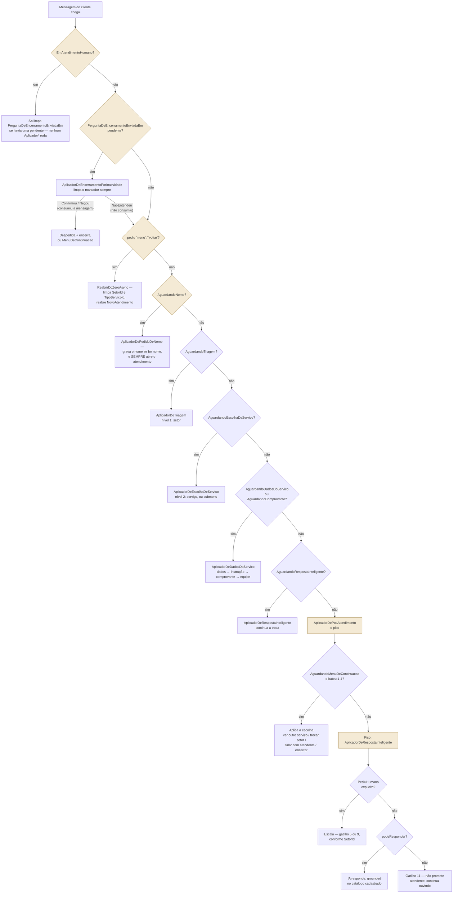

# FLUXO DE AUTOMAÇÃO — MENSAGENS AUTOMÁTICAS E IA

> **Status:** implementado e verificado (Fase 2E — "piso da IA"; Fase 2G — IA
> só escala por pedido explícito; Fase 2H — encerramento automático por
> inatividade; Fase 2I — pedido de nome quando o WhatsApp não traz um; Fase
> 2J — dois provedores de IA, Gemini principal e Haiku de contingência; Fase
> 2K — aviso ao cliente quando o atendente encerra pelo painel, e assinatura
> de autoria no texto que sai pelo WhatsApp; chaves gerais de liga/desliga
> por tenant, §1.1; menu de serviços em níveis, com ordem, submenu, texto
> próprio por serviço e sequência dados → instrução → comprovante, §7.1–7.3;
> espera o cliente terminar de mandar os dados antes da instrução, e texto
> próprio ao receber o comprovante, §7.2).
> **Última atualização:** 2026-09-29
>
> Documento único e definitivo do **comportamento** de automação: o que dispara,
> em que ordem, e por que cada decisão é assim. [MODELO-DADOS.md](MODELO-DADOS.md)
> descreve as colunas; este documento descreve o que elas fazem quando o cliente
> escreve. Onde os dois divergirem, este vale para comportamento e
> MODELO-DADOS.md vale para schema.

---

## 1. A regra que organiza tudo

**O cliente nunca termina uma mensagem sem resposta — não importa em que ponto
da conversa ela chegou.** Não é aspiração: é o requisito que reorganizou este
módulo inteiro em 2026-08-17, depois de um teste ao vivo mostrar conversas
reais caindo em silêncio. Todo caminho deste documento termina numa mensagem ao
cliente, nem que seja "vou te encaminhar para um atendente".

Três mecanismos garantem isso, em camadas, do mais específico para o mais geral:

1. **Mensagem automática** — regra de cadastro (`MensagemAutomatica`), disparada
   por um `GatilhoDeMensagem` específico. Rápida, previsível, de graça.
2. **Resposta Inteligente (IA)** — quando nenhuma regra bate, tenta responder
   com o que está cadastrado no catálogo antes de admitir que não sabe.
3. **`AplicadorDePosAtendimento`** — o piso final. Roda sempre que nenhuma das
   flags de fluxo está ligada, e é ele quem garante que a camada 2 seja
   tentada mesmo quando a conversa "já acabou" do ponto de vista estruturado.

> **Exceção, desde 2026-08-26 (BUG-ATD-01 — Human Takeover):** a regra acima
> vale só enquanto a conversa está em modo automático. Assim que
> `Conversa.EmAtendimentoHumano` liga — cliente pediu atendente, ou um
> atendente assumiu — nenhum dos três mecanismos acima roda mais para
> mensagens do cliente. A mensagem continua sendo gravada e chegando ao
> painel; só a automação conversacional é que se cala. Ver §5 (o gate entra
> ANTES de tudo, inclusive antes da pergunta de encerramento pendente) e o
> README do módulo Atendimento, seção "Human Takeover", para o detalhe
> completo.

### 1.1 Chaves gerais do cartório — desde 2026-09-22

Duas colunas em `Tenant` (migração `sql/049`), ligadas e desligadas **pela
tela**, valendo na próxima mensagem — sem deploy:

| Chave | Onde fica o interruptor | Porta única que respeita | Desligada |
| --- | --- | --- | --- |
| `MensagensAutomaticasHabilitadas` | Automação → Mensagens → Automáticas (topo) | `DisparadorDeMensagemAutomatica.EnfileirarAsync` | **Nenhum** dos 15 gatilhos dispara — inclusive o bot de triagem (pedido de nome, boas-vindas com menu de setores, menu de serviços, despedida). O cliente manda "oi" e não recebe nada |
| `RespostaInteligenteHabilitada` | Automação → IA → Situação (topo) | `RespostaInteligenteService.ResponderAsync` | Devolve o mesmo `PodeResponder=false` de "IA desligada ou sem provedor" — o piso de sempre (§8, gatilho 11; pedido explícito escala) continua valendo |

**A chave de mensagens automáticas é a exceção consciente à regra do §1.**
Decisão do Thiago: quem desliga tem de saber que o cliente fica sem resposta
automática nenhuma, e a tela diz isso com todas as letras (aviso permanente
enquanto desligada, e confirmação antes de desligar). A conversa continua
entrando na fila e o atendente responde normalmente. O efeito é idêntico a
desativar **todas** as linhas de `MensagemAutomatica` uma a uma — estado que o
fluxo já suportava, porque cada aplicador liga a próxima flag de espera
(`AguardandoTriagem`, `AguardandoNome`...) só se algo foi gerado. Granularidade
por regra continua no `Ativo` de cada mensagem.

Consequências nos varredores: o de prazos (§3, gatilhos 3/4) ignora o tenant
desligado ao montar os candidatos — sem isso reivindicaria e desfaria o
marcador de cada conversa a cada passada; o de inatividade (§10) não **pergunta**
com a chave desligada, mas a fase 2 continua fechando (em silêncio) conversa
que já tinha sido perguntada antes — fechar é o efeito, a mensagem é cortesia.

A chave da IA **substitui** o antigo `RespostaInteligente:Habilitada` do
appsettings, que deixou de existir em `OpcoesDaIA`. O appsettings continua
decidindo só infraestrutura: sem provedor com chave (`OpcoesDaIA.EstaConfigurada`),
não há IA, esteja a chave do tenant como estiver. As duas nascem ligadas
(`DEFAULT (1)`) — o comportamento de antes da migração. Permissão para mudar:
`automacao.mensagens.editar` e `ia.conhecimento.editar`, respectivamente.
Coberto por `verificar-automacao.cs`, TESTE 32.

---

## 2. Os três tipos de mensagem gerada pelo sistema

| | Dispara sozinho? | Quem assina | Chega ao cliente? | Onde mora |
| --- | --- | --- | --- | --- |
| **Mensagem automática** | sim | o sistema (regra de cadastro) | sim | `MensagemAutomatica`, `AutorTipo.Sistema` + `EhAutomatica=true` |
| **Resposta da IA** | sim | o sistema (modelo de linguagem) | sim | `AutorTipo.Sistema` + `EhAutomatica=true` + `GeradaPorIa=true` |
| **Anotação de sistema** | sim | ninguém — é registro | nunca | `AutorTipo.Sistema` + `EhAutomatica=false` |

**Até 2026-09-04 as duas primeiras eram indistinguíveis para o cliente** —
chegavam como mensagem normal no WhatsApp, e só a interface do painel rotulava
"Automática" ou "IA" para o atendente. Desde a Fase 2K,
`CanalWhatsApp.Application.AssinaturaDeAutoria` decora o texto **só na saída**
(nunca gravado no banco — ver `Modules/CanalWhatsApp/README.md`): a resposta
da IA sai com o cabeçalho em negrito `*Assistente Virtual*` (numa linha antes
do conteúdo); a mensagem automática de **regra cadastrada** continua sem marca
nenhuma (decisão deliberada — aquele texto já fala na voz institucional do
cartório); e toda mensagem de **atendente** passa a sair com `*Nome do
Atendente*` em negrito antes do conteúdo. A anotação de
sistema continua nunca saindo do painel — é o "Triagem automática encaminhou
ao setor X" que dá contexto ao próximo atendente sem virar mensagem ao cliente.

---

## 3. Os 15 gatilhos

`GatilhoDeMensagem` é **enum, não tabela** — cada valor corresponde a um ponto
de código que precisa existir para disparar. Gatilho novo exige código novo;
**texto** de cada mensagem e **qual etapa dispara** (quando aplicável)
continuam sendo cadastro puro, editável em Configurações → Mensagens
automáticas, sem release.

| # | Gatilho | Quando dispara | Quem provoca |
| --- | --- | --- | --- |
| 1 | `NovoAtendimento` | Conversa aberta sem setor definido — é a mensagem de boas-vindas com o menu de triagem | `ConversaService.CriarAsync`, `AplicadorDePosAtendimento` (ao reabrir por "menu") |
| 2 | `EtapaAlterada` | Conversa entra na etapa marcada como alvo. **Exige** `EtapaAlvoId` preenchido | `ConversaService.MoverAsync` |
| 3 | `PrazoProximoVencimento` | `agora ≥ PrazoAlertaEm`, ainda dentro do prazo | Varredura periódica |
| 4 | `PrazoVencido` | `agora > PrazoLimite` | Varredura periódica |
| 5 | `TriagemSemCorrespondencia` | Resposta ao menu de setor não bate com nenhuma opção — ou o cliente pediu atendente **antes** de ter setor definido | `AplicadorDeTriagem`, `AplicadorDeRespostaInteligente.EscalarAsync` |
| 6 | `TriagemComCorrespondencia` | O setor foi reconhecido e existe ao menos 1 `TipoServico` vinculado a ele — pergunta qual serviço, com `{MenuServicos}` | `AplicadorDeTriagem`, `AplicadorDePosAtendimento` (opção "ver outro serviço"/"trocar de setor") |
| 7 | `ServicoEscolhido` | O cliente escolheu o serviço no menu de 2º nível — confirma com `{DocumentosNecessarios}` e `{PrazoServico}` | `AplicadorDeEscolhaDeServico` |
| 8 | `MenuDeContinuacao` | O atendimento estruturado terminou (checklist entregue) — oferece continuar, trocar de setor, falar com atendente ou encerrar | `AplicadorDeEscolhaDeServico`, logo após o gatilho 7 |
| 9 | `PedidoDeAtendente` | Encaminha para atendente **no meio ou depois** do atendimento (setor já definido) — texto diferente do gatilho 5 de propósito, ver §8 | `AplicadorDeRespostaInteligente.EscalarAsync`, `AplicadorDePosAtendimento` (opção "falar com atendente") |
| 10 | `Despedida` | O cliente escolheu encerrar pelo menu de continuação — envia a despedida **e fecha a conversa de verdade** (`Status = Encerrada`), ver §9 | `AplicadorDePosAtendimento` |
| 11 | `RespostaSemCorrespondencia` | A IA não encontrou, no catálogo cadastrado, como responder — e o cliente **não** pediu atendente. Nunca promete atendente; convida a pedir um se quiser, ver §8 | `AplicadorDeRespostaInteligente` |
| 12 | `ConfirmacaoDeEncerramento` | Conversa de WhatsApp real parada há `Tenant.MinutosParaPerguntarEncerramento` — pergunta se pode encerrar, com menu numerado `1`/`2`. Ver §10 | `VarredorDeInatividade` (fase 1 — perguntar) |
| 13 | `EncerramentoPorInatividade` | Ninguém respondeu à pergunta do gatilho 12 dentro de `Tenant.MinutosParaEncerrarSemResposta` — avisa e fecha a conversa. Ver §10 | `VarredorDeInatividade` (fase 2 — encerrar) |
| 14 | `PedidoDeNome` | O contato chegou sem nome utilizável no perfil do WhatsApp — pergunta como pode chamá-lo **antes** das boas-vindas. Ver §11 | `RecebimentoDeWhatsApp.EnfileirarPrimeiroContatoAsync` |
| 15 | `EncerramentoPeloAtendente` | Um atendente encerrou o atendimento pelo painel — avisa o cliente. Cortesia, não condição (mesma divergência do 13): sem texto ativo a conversa encerra do mesmo jeito. Não reusa `Despedida` (10): aquele é a voz de quem foi atendido até o fim e escolheu fechar; aqui quem fechou foi a serventia. Ver §9 | `ConversaService.EncerrarAsync`, e só ele |

Os gatilhos de 5 a 15 são texto que o **cliente do cartório lê** — por isso
nenhum deles é constante fixa em C#: virariam a única mensagem do sistema que
o cartório parceiro não poderia reescrever sozinho pela tela.

> **O gatilho 14 é o único que não deve usar `{NomeCliente}`.** Ele sai
> justamente porque não há nome utilizável; o marcador resolveria para vazio
> (§11) e a frase funcionaria, mas escrever "Olá, {NomeCliente}!" ali é pedir de
> volta exatamente a mensagem que o gatilho existe para evitar.

`DisparadorDeMensagemAutomatica.EnfileirarAsync` não falha quando não há regra
cadastrada para um gatilho — devolve lista vazia em silêncio. É o cartório parceiro
desligando aquele aviso pela tela (`Ativo=false`), não um erro. Com a chave
geral do tenant desligada (§1.1), devolve lista vazia para **todo** gatilho.

---

## 4. A máquina de estado: as flags `Aguardando*`

Cada flag em `Conversa` significa **"a próxima mensagem do cliente é resposta
a X"**. Todas seguem a mesma disciplina: duram **uma mensagem só**. Acertou ou
não a opção, a flag sai — repetir o menu até o cliente adivinhar prende quem
escreveu "bom dia" num loop de robô, e é o motivo pelo qual gente desiste de
atendimento por WhatsApp.

| Flag | Ligada por | Lida por | Sempre desliga quando |
| --- | --- | --- | --- |
| `AguardandoTriagem` | `NovoAtendimento`, reabertura por "menu" | `AplicadorDeTriagem` | A próxima mensagem do cliente chega, corresponda ou não |
| `AguardandoEscolhaDeServico` | `AplicadorDeTriagem`, quando o setor tem ≥1 serviço vinculado | `AplicadorDeEscolhaDeServico` | Idem |
| `AguardandoRespostaInteligente` | Qualquer resposta da IA, com sucesso ou sem (`RespostaSemCorrespondencia`) | `AplicadorDeRespostaInteligente` (chamado direto, fora do `AplicadorDePosAtendimento`) | A IA escala — **só por pedido explícito**, desde 2026-08-18 — ou o cliente pede "menu" |
| `AguardandoMenuDeContinuacao` | `ServicoEscolhido`, logo após o checklist | `AplicadorDePosAtendimento` | A próxima mensagem do cliente chega, corresponda ou não a uma das 4 opções |
| `ServicoDoSubmenuId` | `AplicadorDeEscolhaDeServico`, quando o serviço escolhido agrupa outros (§7.1) | `AplicadorDeEscolhaDeServico` — decide qual lista é o menu no ar | A próxima escolha chega, corresponda ou não. Também zerado por "menu", encerramento e "ver outro serviço" |
| `AguardandoDadosDoServico` | `AplicadorDeEscolhaDeServico`, quando o serviço tem `MensagemAposDados` (§7.2) | `AplicadorDeDadosDoServico` (marca o começo) e `VarredorDeDadosDoServico` (responde) | **Exceção à regra de uma mensagem só:** dura enquanto o cliente manda os dados, e desliga quando o fio fica em silêncio (§7.2) |
| `DadosDoServicoRecebidosEm` | `AplicadorDeDadosDoServico`, na primeira mensagem de dados | `VarredorDeDadosDoServico` — só olha conversa com o campo preenchido | Junto com `AguardandoDadosDoServico`; também zerado por "menu" e encerramento |
| `AguardandoComprovante` | `AplicadorDeDadosDoServico`, depois de mandar a `MensagemAposDados` | `AplicadorDeDadosDoServico` | A próxima mensagem do cliente chega — qualquer uma conta como o comprovante, e o atendimento passa para a equipe |
| `TentativasRespostaInteligente` | Incrementado a cada resposta **bem-sucedida** da IA | — | Zerado ao escalar. **Não é mais lido por nenhuma decisão** (ver §8) — contador informativo |
| `AguardandoNome` | `RecebimentoDeWhatsApp`, na 1ª mensagem de contato sem nome utilizável (gatilho 14) | `AplicadorDePedidoDeNome` | A próxima mensagem do cliente chega — seja ela um nome ou não. Ver §11 |
| `PerguntaDeEncerramentoEnviadaEm` | `VarredorDeInatividade`, fase 1 (gatilho 12) | `AplicadorDeEncerramentoPorInatividade.TratarRespostaAsync` | **Qualquer** mensagem do cliente chega — mesmo que não seja `1`/`2`/palavra reconhecida (ver §10). Também zerado ao atendente responder, ao reabrir a conversa e ao desligar o recurso pela tela |

Diferente das flags acima, este campo **não dura uma mensagem só por
convenção de fluxo** — dura até a próxima mensagem do cliente (que pode levar
minutos ou dias) porque ele é ao mesmo tempo o relógio da fase 2 do varredor.
Ver §10.

Se um atendente rotear a conversa manualmente enquanto `AguardandoTriagem`
está ligada, a escolha da pessoa vale: a flag é limpa em silêncio, sem
mensagem ao cliente (`AplicadorDeTriagem`, guarda no topo do método, testando
`SetorId is not null`). **Historicamente esta era a única proteção contra
automação reagindo com atendente já na conversa** — e cobria só este caso
específico (setor já definido). Desde 2026-08-26 (BUG-ATD-01), o gate de
`EmAtendimentoHumano` (§5) intercepta ANTES de `AplicadorDeTriagem` sequer
ser chamado, cobrindo todos os casos — esta guarda por `SetorId` continua
aqui, mas ficou redundante na prática.

---

## 5. O despacho: "menu" primeiro, dois níveis depois

O ponto de entrada — `MensagemService.SimularRecebimentoAsync` e
`RecebimentoDeWhatsApp.ReceberAsync` (webhook real) — roda a **mesma** cadeia,
porque duplicá-la faria as duas divergirem na primeira mudança, e a
divergência só apareceria na conversa de um cliente de verdade.

> **Desde 2026-08-18 o painel não chama mais o primeiro.** O botão "Simular
> mensagem do cliente", que ficava sob a caixa de envio, era andaime da Fase 1 —
> quando não havia WhatsApp nenhum e o painel precisava encenar a chegada de uma
> mensagem. Com o canal real no ar, mensagem de cliente se testa pelo WhatsApp.
> **O método e a rota continuam existindo**, e continuam sendo o caminho de
> `verificar-automacao.cs`: é por ali que os 56 cenários de automação entram no
> sistema sem depender de gateway.

**`EmAtendimentoHumano` (`H0`) é checado ANTES de tudo, inclusive antes da
pergunta de encerramento pendente — desde 2026-08-26 (BUG-ATD-01).** Nenhuma
automação conversacional roda para uma conversa já entregue a um humano; a
única exceção é limpar `PerguntaDeEncerramentoEnviadaEm` como prova de vida,
se houver uma pendente (mesmo raciocínio de `Y`, aplicado sem acionar
`AplicadorDeEncerramentoPorInatividade`). Ver README do módulo, seção
"Human Takeover".

**A pergunta pendente de encerramento (`Y`) é checada ANTES até do "menu" —
é o primeiro passo do despacho automático (depois do gate acima), desde
2026-08-22.** `TratarRespostaAsync`
**sempre** limpa o marcador antes de decidir, porque qualquer mensagem, seja
qual for o conteúdo, prova que o cliente ainda está ali. Se a resposta for
`Confirmou` ou `Negou`, a mensagem foi tratada por completo (despedida +
encerra, ou volta ao menu de continuação) e a cadeia para aqui. Se for
`NaoEntendeu` — inclusive "menu" —, a mensagem **continua para `Z`** com o
marcador já limpo: é assim que digitar "menu" com uma pergunta de
encerramento pendente cancela o encerramento **e** reabre do zero, no mesmo
turno. Ver §10 para as guardas e o porquê da distinção Confirmou/Negou/
NaoEntendeu.

**`AguardandoNome` (`X`) fica logo abaixo do "menu", e acima de todo o resto.**
Abaixo do "menu" porque a saída de emergência foi hasteada acima de *todas* as
flags em 2026-08-18 justamente para nenhuma delas tomá-la refém — e esta é mais
uma flag. Acima do resto porque, neste ponto, o cliente ainda não recebeu o
menu de setores: `AguardandoTriagem` está desligada, e deixar a mensagem cair
pela cadeia levaria o **primeiro contato** de alguém direto ao piso da IA, que
responderia "não tenho essa informação específica". Ver §12.

**"menu"/"voltar" (`Z`) é checado ANTES de qualquer flag do nível externo —
mas depois de `Y`.** Não foi sempre assim: até 2026-08-18 isso só era
verificado dentro de `AplicadorDePosAtendimento`, que só roda quando nenhuma
das três flags do nível externo está ligada. Um cliente com
`AguardandoRespostaInteligente` ligada (o normal depois de qualquer troca com
a IA, inclusive sem sucesso — ver §8) digitava "menu" e a mensagem ia direto
para a IA, que não entende "menu" como comando e respondia qualquer coisa. Ver
`AplicadorDePosAtendimento.ReabrirDoZeroAsync` para o código — hoje é chamado
pelos dois pontos de entrada, antes de olhar qualquer flag.

`ReabrirDoZeroAsync` também **limpa `SetorId` e `TipoServicoId`** — segundo
achado no mesmo dia: sem isso, um cliente que já tinha setor definido e pedia
"menu" ficava com o campo preenchido mesmo depois de "recomeçar", e
`AplicadorDeTriagem` — ao ver `SetorId != null` com `AguardandoTriagem` ligada
— interpreta isso como "um atendente já assumiu manualmente" (guarda pensada
para este cenário específico, ver §6) e **não faz nada**: nem responde, nem
escala. "Do zero" agora é literal. **Nota 2026-08-26:** este continua sendo o
comportamento para `SetorId` preenchido sem `EmAtendimentoHumano` ligado (ex.:
conversa aberta pelo painel já com setor) — quando `EmAtendimentoHumano` está
ligado, quem intercepta primeiro é o gate do §5, e `AplicadorDeTriagem` nem
chega a ser chamado.

**A segunda caixa (B/C/D) é o nível externo** — três flags específicas, cada
uma com um `Aplicador*` próprio. **`AplicadorDePosAtendimento` é o `else`** —
roda quando nenhuma das três está ligada, o que acontece em três situações
reais:

- O atendimento estruturado **terminou** (checklist entregue, menu de
  continuação já respondido ou nunca chegou a bater em nenhuma opção).
- A conversa **nunca passou pela triagem** (aberta direto pelo painel, com
  setor já definido).
- A IA **acabou de escalar** nesta mesma mensagem — não; nesse caso quem
  respondeu já foi `AplicadorDeRespostaInteligente` dentro do nível externo
  (`D`), e a próxima mensagem do cliente é que cairá aqui.

Dentro do `else`, **há um segundo nível de decisão**: a interpretação do menu
de continuação, se estiver no ar; e só então o piso. Uma mensagem que não bate
em nada do meio ainda cai para a IA **na mesma passada** — não custa um turno
extra pedindo "responda 1, 2, 3 ou 4".

---

## 6. Nível 1 — triagem por setor

1. Conversa nasce **sem setor** → dispara `NovoAtendimento`, liga
   `AguardandoTriagem`. O menu sai numerado com os setores **ativos**, na
   ordem do cadastro (`Setor.Ordem`).
2. A resposta do cliente é lida por
   [`TriagemAutomatica.InterpretarResposta`](../src/backend/CrmCartorio.Api/Modules/Atendimento/Domain/TriagemAutomatica.cs) —
   mesmo algoritmo do nível 2, ver §7 da classe:
   1. **Número da opção** (`1`, `2`...) — tentado primeiro, é o que o menu pede.
   2. **Nome exato**, normalizado (sem acento, minúsculo, sem pontuação).
   3. **Nome parcial**, nas duas direções (`"quero registro civil"` contém o
      nome; `"notas"` está contido nele), com mínimo de 3 caracteres e
      **exigindo correspondência única** — ambíguo devolve nulo, do mesmo
      jeito que não-reconhecido.
3. **Reconheceu um único setor:** grava `SetorId`, registra em
   `HistoricoEtapa` com `AtendenteId` nulo (convenção do modelo para "mudança
   automática"), deixa uma anotação interna no fio. Se o setor tiver ao menos
   1 `TipoServico` vinculado (`TipoServico.SetorId`), dispara
   `TriagemComCorrespondencia` e liga `AguardandoEscolhaDeServico` — nível 2.
4. **Não reconheceu, ou reconheceu mais de um:** cai para a Resposta
   Inteligente (§7) antes de escalar — a IA tenta resolver o que a triagem
   fixa não conseguiu antes de admitir que precisa de gente.

> **Caso conhecido, sem correção proposital** — ver
> [REQUISITOS.md §5.8](REQUISITOS.md): se um atendente assumir a conversa
> manualmente enquanto o menu de triagem ainda está no ar, e o cliente
> responder algo fora do menu, o sistema ainda dispara o encaminhamento —
> mesmo já havendo responsável. Decisão de atendimento, não de código; fica
> com o cartório parceiro.

---

## 7. Nível 2 — escolha do serviço

Mesmo algoritmo do nível 1, um degrau abaixo: dentro do setor já reconhecido,
`{MenuServicos}` lista os `TipoServico` **ativos** vinculados àquele setor
(`TipoServico.SetorId`), e a resposta é interpretada pelas mesmas três regras
(número, nome exato, nome parcial com mínimo 3 caracteres).

- **Reconheceu:** grava `TipoServicoId`, dispara `ServicoEscolhido` (confirma
  com `{DocumentosNecessarios}` e `{PrazoServico}`) e, na sequência, **também**
  dispara `MenuDeContinuacao` e liga `AguardandoMenuDeContinuacao` — o
  atendimento estruturado chegou ao fim, mas a conversa não pode terminar
  muda.
- **Não reconheceu:** cai para a Resposta Inteligente, mesma regra do nível 1.

### 7.1 Ordem e submenu — desde 2026-09-29

Pedido do cartório parceiro: o menu do Registro Civil na ordem dele, e "Segunda via de
certidão" abrindo um segundo menu com nascimento, casamento e óbito. Três
campos novos em `TipoServico` (migração `sql/052`), todos pela tela de
Serviços:

- **`Ordem`** — posição no menu. Menor primeiro; empate, e o padrão zero, cai
  na ordem alfabética, que era a única até aqui. Quem nunca mexeu vê o menu de
  sempre.
- **`ServicoPaiId`** — "aparece dentro de". O serviço sai do menu do setor e
  só aparece quando o cliente escolhe o pai. **Um nível só**, no mesmo setor
  do pai: o cadastro recusa pai que já é filho, filho que já agrupa outros e
  setores diferentes.
- **`MensagemAoEscolher`** — o texto que o robô manda quando o serviço é
  escolhido, **no lugar** do gatilho 7. Mesmos marcadores (§13).

Escolher um serviço que agrupa outros grava `TipoServicoId` com ele (o painel
já mostra o assunto), liga `ServicoDoSubmenuId` e `AguardandoEscolhaDeServico`
e manda a pergunta: a `MensagemAoEscolher` do pai, com `{MenuServicos}`
resolvido para a lista de dentro, ou — sem texto próprio — o gatilho 6 de
sempre, que também resolve para a lista de dentro. A escolha seguinte é lida
contra essa lista, pelas mesmas três regras de interpretação.

`ServicoDoSubmenuId` fica à parte de `TipoServicoId` de propósito: o serviço
da conversa muda por outros caminhos (painel, "ver outro serviço"), e o menu
que o cliente está lendo não pode mudar junto sem ele saber.

### 7.2 Dados → instrução → comprovante → equipe

Quarto campo: **`MensagemAposDados`**. Preenchido, o serviço deixa de terminar
no menu de continuação e passa a seguir, com `AplicadorDeDadosDoServico`:

1. Depois da `MensagemAoEscolher` (que pede os dados), liga
   `AguardandoDadosDoServico` — **sem** menu de continuação no meio, que
   confundiria quem está digitando nome e CPF.
2. A próxima mensagem do cliente, qualquer que seja, conta como começo dos
   dados: grava `DadosDoServicoRecebidosEm` e uma anotação no painel, **sem
   responder**. As mensagens seguintes só empurram `UltimaMensagemEm`.
3. Quando o fio fica em silêncio por 45 segundos (§7.2.1), a varredura manda a
   `MensagemAposDados` (no pedido do cartório parceiro, a chave Pix) e liga
   `AguardandoComprovante`.
4. A mensagem seguinte passa o atendimento para a equipe, com
   `EmAtendimentoHumano = true` — o mesmo desfecho da opção "falar com
   atendente". O aviso ao cliente é a **`MensagemAposComprovante`** do serviço
   (quinto campo, migração `sql/053`, ex.: "Recebemos seu comprovante!"); vazia,
   o gatilho 9 (`PedidoDeAtendente`) de sempre.

**Qualquer mensagem avança o passo**, inclusive "já paguei" sem foto. O robô
não tem como saber se os dados vieram completos, nem se uma imagem é mesmo
comprovante; tentar adivinhar prenderia o cliente num laço de "não entendi".
Quem confere tudo é o atendente, no fim. Se o texto sumir do cadastro no meio
do caminho, o passo 3 passa direto para a equipe — nunca fica mudo.

#### 7.2.1 Por que esperar o silêncio — desde 2026-09-29

Teste ao vivo do menu do cartório parceiro, no mesmo dia em que ele entrou: com os dados
numa mensagem só, o fluxo saiu perfeito. Mas muita gente manda o nome numa
mensagem, o CPF em outra e a data em outra. Respondendo à primeira, o Pix saía
no meio da digitação, e o CPF que vinha depois era tomado como comprovante — o
atendimento ia para a equipe antes da hora.

`VarredorDeDadosDoServico`, num `BackgroundService` próprio
(`HospedeDaEsperaDeDados`), roda a cada 10 segundos e responde a conversa que:

- está com `AguardandoDadosDoServico` e `DadosDoServicoRecebidosEm` preenchido,
  ativa e sem atendente (`EmAtendimentoHumano` desligado);
- tem `UltimaMensagemEm` há mais de 45 segundos;
- **não** tem mensagem do cliente aceita e ainda não processada pela fila do
  webhook — essa mensagem também é digitação.

A instrução sai, portanto, entre 45 e 55 segundos depois da última mensagem de
dados. Os dois tempos estão em `Automacao` no appsettings
(`SegundosDeSilencioAntesDaInstrucao`, `IntervaloDaEsperaDeDadosEmSegundos`),
com a chave de emergência `EsperarDadosDoServico`.

**Corrida com o webhook.** A varredura carrega a conversa rastreada e salva
com o `RowVersion`: se o cliente escreveu entre a leitura e a gravação, ela
perde, desiste em silêncio, e a janela recomeça. Se quem perde é o webhook, ele
descarta a própria automação sem erro (`SalvarSemRepetirEfeitosAsync`) — a
mensagem fica gravada, e a próxima do cliente segue o passo 4.

Não filtra `Canal == WhatsApp`, ao contrário do varredor de inatividade: a
conversa simulada chega aqui só se alguém percorreu o menu nela, e aí deve ver
o mesmo fluxo.

"menu", encerramento (pelo cliente, pelo atendente ou por inatividade) e a
resposta "não" à pergunta de inatividade desligam as duas flags. A chave geral
de mensagens automáticas (§1.1) também vale aqui: desligada, nenhum texto
próprio sai e nenhuma espera liga.

### 7.3 O texto próprio é mensagem automática

`DisparadorDeMensagemAutomatica.EnfileirarTextoAsync` gera a
`MensagemAoEscolher`, a `MensagemAposDados` e a `MensagemAposComprovante`
exatamente como uma regra
cadastrada: `AutorTipo.Sistema` + `EhAutomatica`, marcadores resolvidos,
limite de 4000 caracteres, chave geral respeitada, saída pela mesma fila. O
texto vive no **serviço** porque é dele que o cartório lembra ("o que a
certidão de óbito responde?"), não num gatilho.

**Texto longo sai em mais de uma mensagem — desde 2026-09-29.** Uma linha só
com `---` divide o texto cadastrado em partes, e cada parte vira uma mensagem,
na ordem (`Configuracoes/Domain/PartesDeMensagem`). O WhatsApp não aceita mais
de 4096 caracteres numa mensagem, e o texto do cartório parceiro para habilitação de
casamento tem 4217. O cadastro aceita até 12000 no total e recusa, com o número
da parte, a que passar de 4000 — cortar o texto de um cartório em silêncio não
é opção. As três colunas de texto do serviço são `NVARCHAR(MAX)` desde a
migração `sql/053`. A divisão acontece antes dos marcadores: quem decide as
partes é o que o cartório escreveu, nunca o nome de um cliente.

Coberto por `verificar-menu-em-niveis.cs` (em memória): ordem, submenu, o
caminho inteiro até a equipe — dados em três mensagens, a varredura real
esperando o silêncio e mandando o Pix uma vez só, o texto próprio do
comprovante —, o aviso geral quando o serviço não tem texto do comprovante,
serviço com texto próprio sem sequência de dados, a mensagem geral de sempre
para quem não configurou nada, as recusas do cadastro, "menu" zerando tudo e a
chave geral desligada.

> **Lacuna conhecida, ainda não fechada:** se um setor for cadastrado **sem
> nenhum** `TipoServico` vinculado (`SetorId` nunca preenchido em nenhum
> serviço), `AplicadorDeTriagem` reconhece o setor normalmente, mas **não**
> dispara `TriagemComCorrespondencia` nem liga nenhuma flag — a mensagem que
> escolheu aquele setor fica sem resposta por um turno (a mensagem
> *seguinte* do cliente já cai no piso normalmente, via `AplicadorDePosAtendimento`).
> Não acontece com o cadastro atual (os dois setores semeados têm serviço
> vinculado), mas é uma lacuna estrutural, não coberta pelo piso da IA da
> mesma forma que o resto do fluxo. Sinalizado para correção — ver tarefa
> aberta, não é bloqueio para uso normal do sistema hoje.

---

## 8. A Resposta Inteligente (IA)

Camada de contingência: responde **só com o que está cadastrado**, nunca
inventa. Ver também o `README` do módulo
[`RespostaInteligente`](../src/backend/CrmCartorio.Api/Modules/RespostaInteligente/README.md).

**Desde 2026-08-25 (Fase 2J — dois provedores):** por trás de
`IRespostaInteligenteService` existem dois provedores, escolhidos por um
`OrquestradorDeProvedores` — **Gemini 3.7 Flash é o principal** (gratuito
dentro da franquia), **Claude Haiku 4.5 é a contingência** (paga). A troca é
transparente: o cliente nunca sabe qual dos dois respondeu. Detalhe completo
na §8.1 abaixo.

### Quando é chamada

- Nível 1 ou nível 2 não reconheceram a resposta do cliente.
- `AguardandoRespostaInteligente` está ligada (troca em andamento) — chamada
  direto do nível externo do despacho (§5, caixa `D`), sem passar pelo `else`.
- Como piso, dentro de `AplicadorDePosAtendimento`, para qualquer mensagem que
  não bateu em nada mais — incluindo "obrigada", "ok", ou qualquer texto solto
  depois que o atendimento estruturado já terminou.

### O que ela vê (`MontadorDeContexto`)

- **Catálogo:** nome, **setor** (entre parênteses) e descrição de cada
  `TipoServico` ativo. O setor entrou em 2026-08-18 — sem ele, "quais os
  serviços de notas?" não tinha como ser respondido: a lista de nomes chegava
  sem nenhuma pista de a qual setor cada um pertence, e a IA, corretamente,
  recusava adivinhar. **Desde então também inclui, quando cadastrados,
  `DocumentosNecessarios` e o `Prazo`** (SLA de `PrazoServico`, convertido de
  horas para a unidade de balcão) — antes ficavam de fora e a IA recusava
  perguntas de documento/prazo mesmo com o dado no banco; só chegavam ao
  cliente por marcador em mensagem automática roteirizada. Correção de doc,
  2026-09-11: esta seção dizia o oposto (que o grounding não incluía os dois
  campos) — o código (`MontadorDeContexto.cs`) já os inclui.
- **Respostas rápidas ativas**, com `{NomeCartorio}` resolvido e qualquer
  outro marcador removido (não fazem sentido fora de uma conversa específica).
- **Histórico da própria troca**: mensagens do cliente (exceto a primeiríssima,
  que abriu o atendimento e nunca passou pela IA) intercaladas com as
  respostas já dadas pela IA (`GeradaPorIa=true`) — reconstruído do banco a
  cada chamada, nunca guardado em memória entre requisições.

Ela **não vê**: dado de outro cliente, conversa de outra pessoa, nem nada fora
do tenant atual.

### As regras do prompt (fixo em código, não cadastro)

Ver [`PromptDeSistema.cs`](../src/backend/CrmCartorio.Api/Modules/RespostaInteligente/Application/PromptDeSistema.cs) —
texto completo, versionado, não editável pela tela de propósito (é regra de
segurança, não redação). Resumo das sete regras:

1. Responde só com base no contexto — nunca inventa prazo, valor, documento
   ou qualquer dado ausente.
2. Deixa claro que é atendimento automático quando fizer sentido — nunca finge
   ser pessoa.
3. Nunca dá opinião jurídica nem interpreta o caso específico de quem
   pergunta — isso é atendente humano.
4. **Tenta sempre antes de desistir.** "Não entendi", "?", mensagem confusa:
   motivo para reexplicar ou perguntar de volta, não para `podeResponder=false`.
   Reserva a desistência só para pedido de opinião jurídica sobre o caso
   específico, ou pergunta cuja resposta não existe em lugar nenhum do
   contexto.
5. Respostas curtas, português do Brasil, tom cordial. Emoji pontual e com
   propósito é permitido (📍 endereço, 📄 documento, ⏱️ prazo) — nunca solto,
   nunca mais de um por ideia.
6. Se posiciona como exceção, não caminho principal: quando fizer sentido,
   fecha convidando a pessoa a voltar às opções numeradas já enviadas.
7. **(2026-08-18)** Puro agradecimento ou confirmação ("obrigada", "entendi",
   "só isso", "somente") não é pergunta sem resposta — é fechamento de
   conversa. `podeResponder=true`, frase curta e cordial, sem inventar
   pergunta nem mencionar atendente.

### Quando ela escala — e quando NÃO escala

**Só escala por pedido EXPLÍCITO do cliente (`TriagemAutomatica.PediuHumano`).
Nunca por contagem de trocas, e — desde 2026-08-18 — nunca só porque ela
mesma não sabia responder desta vez.**

Duas correções, na mesma direção, em dias diferentes:

- **2026-08-17 — contagem de trocas.** Até então existia um
  `OpcoesDaIA.MaxTrocas` (padrão 3) que forçava escalonamento após N respostas
  bem-sucedidas seguidas — **mesmo quando a IA tinha acabado de responder
  certo**. Removido depois de aparecer ao vivo: cliente recebia a resposta
  correta e, no mesmo fôlego, uma mensagem de "um atendente vai continuar" sem
  ele ter pedido nada. `TentativasRespostaInteligente` continua existindo e
  sendo incrementado (telemetria), mas **nenhuma decisão lê esse número hoje**.

- **2026-08-18 — `podeResponder=false` sozinho.** Até então, quando a IA não
  encontrava resposta no catálogo — mesmo sem o cliente ter pedido nada —
  o sistema escalava do mesmo jeito. Dois clientes reais, no mesmo dia,
  receberam "um atendente vai continuar" por terem dito só "somente" (queria
  dizer "só isso, obrigado") ou por terem perguntado algo que a IA não sabia.
  Um caso ainda pior: depois de escalar, QUALQUER mensagem seguinte do
  cliente ("ok, obrigada", "obrigada") reabria o mesmo ciclo — a IA era
  chamada de novo (sem memória de ter acabado de escalar, porque a mensagem
  de escalonamento não é `GeradaPorIa`), não tinha o que responder de novo, e
  escalava de novo, repetindo o texto verbatim várias vezes na mesma conversa.
  Agora `podeResponder=false` sem `PediuHumano` dispara
  `GatilhoDeMensagem.RespostaSemCorrespondencia` (§3) — nunca promete
  atendente, convida a pedir um se quiser — e mantém
  `AguardandoRespostaInteligente` ligada: a IA não desiste da conversa só por
  não ter tido o que dizer desta vez em particular.

O prompt (`PromptDeSistema`, regra 7) também foi ajustado no mesmo dia: puro
agradecimento ou confirmação ("obrigada", "entendi", "só isso") não é mais
tratado como pergunta sem resposta — é fechamento de conversa, e a IA deve
responder com `podeResponder=true` e uma frase cordial, sem escalar. Isso
reduz a frequência do caminho `RespostaSemCorrespondencia` para esses casos
específicos, mas o caminho continua existindo como rede de segurança para
perguntas genuinamente fora do catálogo.

Quando escala de verdade, o texto varia por contexto — ver §11.

### 8.1 Gemini principal, Haiku de contingência

`OrquestradorDeProvedores` (`Modules/RespostaInteligente/Application/`) decide,
a cada mensagem, se tenta o Gemini e cai para o Haiku quando necessário — sem
retry duplo, sem duas respostas para a mesma mensagem. O prompt (§ acima) é o
mesmo texto para os dois provedores; só o transporte HTTP muda (Gemini fala
pela Interactions API do Google, `POST /v1/interactions`, via `HttpClient`
tipado — não existe SDK .NET oficial para essa API; Haiku continua no SDK
`Anthropic`).

**Quando o Gemini é pulado preventivamente** (antes de qualquer chamada):

- Sem chave configurada ou `Gemini:Habilitado=false`.
- Margem de segurança da franquia atingida (§8.2).
- Disjuntor aberto (§8.3) — Gemini teve falha recente e está em cooldown.

**Fallback reativo** — o Gemini é tentado e o Haiku assume quando ele:

| Situação | Classificação (`TipoDeFalhaDeIa`) |
| --- | --- |
| `429` de limite de requisições | `RateLimit` |
| `429` de cota diária esgotada | `QuotaEsgotada` |
| `500`/`502`/`503`/`504` | `Indisponibilidade` |
| Timeout da nossa chamada | `Timeout` |
| Falha de rede/DNS | `Rede` |
| `400`/`401`/`403` (chave ou requisição inválida) | `Configuracao` — **log em nível `Error`**, nunca mascarado |
| JSON fora do esquema pedido, resposta vazia | `RespostaInvalida` |

`podeResponder=false` **não é falha** — é resposta válida do modelo (ele
respondeu, só não sabia o que dizer). Nesse caso o Haiku **não** é chamado; o
fluxo cai no mesmo `RespostaSemCorrespondencia` de sempre (§ acima).

Cada tentativa (sucesso ou falha) vira uma linha em `dbo.ChamadasDeIa` —
tokens, latência, custo estimado, motivo do fallback quando houver. Gravada
num `DbContext` **próprio** (não o da requisição): fica registrada mesmo
quando os dois provedores falham e nenhuma `Mensagem` chega a ser criada.

### 8.2 Controle de cota do Gemini — global do projeto, não por tenant

A franquia gratuita do Gemini é por **projeto Google**, não por tenant nem por
chave individual — por isso `ContadorDeCotaDoGemini` e `DisjuntorDoGemini` são
**singletons globais**, particionados só por um fingerprint não-secreto da
chave (`FingerprintDeChave`, nunca a chave em si). Dois tenants usando o mesmo
projeto Google **compartilham** RPM/TPM/RPD; os tetos de negócio (§8.4) e as
métricas de custo continuam por tenant.

`Gemini:LimiteRpm`/`LimiteTpm`/`LimiteRpd` nascem em `0` (não cadastrado) — o
Google parou de publicar esses números na documentação pública; só aparecem
no painel `aistudio.google.com/rate-limit` de cada conta. **Confirmado por
chamada real em 2026-08-25** (conta de teste, free tier): a resposta de erro
citou explicitamente `limit: 20` para a métrica
`generate_content_free_tier_requests` do modelo `gemini-3.7-flash` — ou seja,
RPM=20 **naquela conta**. É um dado real, não suposição, mas é por projeto:
reconfirme antes de usar em produção.

Com os limites cadastrados, o Gemini só é escolhido enquanto o consumo fica
abaixo de `PercentualDeSeguranca` (85% por padrão) de cada limite. Com os
limites em `0`, não existe "85% de uma cota desconhecida": o sistema aplica
só um freio local conservador (`LimiteRpmDeDescoberta`) e deixa a camada
reativa (429 real) ser a autoridade.

### 8.3 O disjuntor — recuperação automática

`DisjuntorDoGemini`: `Fechado` → `Aberto` → `Meio-Aberto`. Falhas normais
(indisponibilidade, timeout, resposta inválida) abrem o circuito depois de
`FalhasParaAbrirDisjuntor` (3) consecutivas; `429` de rate limit e erro de
credencial (`401`/`403`) abrem **na hora**, sem esperar 3 falhas. Cota diária
esgotada abre até a **meia-noite do horário do Pacífico** (é quando o RPD do
Google reseta), não o cooldown curto.

Vencido o cooldown, a **próxima mensagem real** vira uma sonda: se o Gemini
responder, o circuito fecha e ele volta a ser principal; se falhar, o
cooldown dobra (até `CooldownMaximoSegundos`). Só uma sonda por vez — outras
mensagens simultâneas continuam no Haiku sem esperar o resultado dela.

### 8.4 Os dois tetos diários

| Teto | Conta o quê | Ao estourar |
| --- | --- | --- |
| `RespostaInteligente:LimiteDiario` (300, por tenant, dia UTC) | Respostas **entregues** ao cliente, qualquer provedor — uma por mensagem | IA para de responder pelo resto do dia; cai no encaminhamento humano de sempre |
| `RespostaInteligente:Anthropic:LimiteDiarioHaiku` (60, por tenant, dia UTC) | Só respostas produzidas **pelo Anthropic** | Gemini continua normalmente até o teto geral; só o Haiku para |

Os dois são reservados de forma atômica (`ContadorDeLimiteDiario`, em
memória, hidratado de `ChamadasDeIa` na primeira mensagem do processo) —
corrige a condição de corrida que a contagem direta no banco tinha antes de
existirem dois provedores. Gemini falhar e o Haiku responder conta **1** no
teto geral e **1** no teto do Haiku — nunca 2 no geral.

Se os dois estourarem no mesmo dia, cai no atendimento humano de sempre —
nunca deixa o cliente mudo.

### 8.5 Painel `/automacao/ia`

Mostra estado dos dois provedores (disponível / contingência / sem chave /
teto atingido), consumo de hoje, franquia do Gemini (ou aviso de "não
cadastrada"), motivos de fallback do período e economia estimada vs. 100%
Haiku. Backend: `GET /api/ia/situacao` (`ISituacaoDaIa`) — o mesmo cálculo
alimenta o card "Saúde da operação" da Visão Geral e o alerta `ia_limite_atingido`
do sino, que antes duplicavam a contagem em 3 lugares diferentes.

---

## 9. O piso: `AplicadorDePosAtendimento`

A peça que fecha o buraco encontrado ao vivo em 2026-08-17: sem ela, o
despacho externo (§5) simplesmente terminava quando nenhuma das três flags
batia, e a mensagem ficava gravada sem gerar resposta nenhuma. Roda **sempre**
que chega aqui — nunca decide "não vou responder isso". Desde 2026-08-18,
`ReabrirDoZeroAsync` ("menu"/"voltar") não mora mais aqui — é checado no
despacho, antes desta classe ser chamada (§5).

Cascata, em ordem:

1. **`AguardandoMenuDeContinuacao` ligada:** interpreta a resposta contra as 4
   opções fixas (não são cadastro — GUIDs constantes, únicos, nunca mudam):

   | # | Opção | Efeito |
   | --- | --- | --- |
   | 1 | Ver outro serviço | Se o setor atual tem mais de 1 serviço: dispara `TriagemComCorrespondencia` de novo, liga `AguardandoEscolhaDeServico`. Sem outro serviço: mesmo efeito da opção 2 |
   | 2 | Trocar de setor | Dispara `NovoAtendimento`, liga `AguardandoTriagem` — reabre do zero |
   | 3 | Falar com atendente | Dispara `TriagemSemCorrespondencia` (sem setor) ou `PedidoDeAtendente` (com setor) |
   | 4 | Encerrar | Dispara `Despedida` **e fecha a conversa** — ver abaixo |

   Sem corresponder a nenhuma das 4, **não trava pedindo de novo**: desliga a
   flag e deixa a mesma mensagem cair para o piso da IA, na mesma passada.
2. **Piso final:** delega para `AplicadorDeRespostaInteligente` (§8) — a IA
   tenta responder; sem sucesso, responde com `RespostaSemCorrespondencia`
   (não escala sozinha — só por pedido explícito). É o que garante que
   literalmente nenhuma mensagem do cliente saia sem resposta, seja qual for
   o conteúdo ou o momento da conversa.

### Encerrar pelo cliente fecha a conversa de verdade

Achado ao vivo em 2026-08-17, corrigido no mesmo dia: até então, a opção
"Encerrar" do menu de continuação só disparava a mensagem de despedida — a
conversa continuava `Status = Ativa` no painel para sempre. Hoje,
`EncerrarPeloCliente` (dentro de `AplicadorDePosAtendimento`) espelha
`ConversaService.EncerrarAsync`, sem exigir um atendente logado:

- `Status = Encerrada`, `EncerradaEm = agora`, `EncerradaPorAtendenteId = null`
  (foi o cliente, não um atendente).
- `MotivoEncerramento` fixo: `"Encerrado pelo cliente, via menu do WhatsApp."`
- Zera `MensagensNaoLidas`, `AguardandoRespostaInteligente` e
  `TentativasRespostaInteligente` — nenhuma flag de "esperando resposta" deve
  sobreviver a um encerramento.
- Deixa uma anotação interna no fio ("Atendimento encerrado pelo cliente."),
  mesma convenção de `AplicadorDeTriagem` e `AplicadorDeEscolhaDeServico`.

Coberto por teste — `verificar-automacao.cs`, TESTE 7.

### Encerrar pelo atendente também avisa o cliente — desde 2026-09-04

Dos quatro caminhos que encerram uma conversa (pelo cliente, acima; pela
resposta à pergunta de inatividade e pelo próprio varredor, §10; e este),
**este era o único que fechava em silêncio.** `ConversaService.EncerrarAsync`
agora enfileira o gatilho 15 (`EncerramentoPeloAtendente`) e envia **só a
mensagem gerada** — nunca `EnviarPendentesAsync`, que drenaria qualquer
automática parada há tempo naquela conversa (menu de continuação, boas-vindas
presas por canal caído) junto da despedida, arriscando o cliente responder a
um menu morto e reabrir um atendimento fantasma no mesmo instante em que este
foi fechado. Guardado por `Canal == WhatsApp`, mesmo cuidado do varredor de
inatividade (§10, guarda 2) — conversa simulada não gera nada. O motivo
digitado pelo atendente fica só na anotação interna; o texto do gatilho 15 não
tem como nomeá-lo.

---

## 10. Encerramento automático por inatividade

**O problema que isto resolve:** antes desta fase, `Status = Ativa` era um
estado permanente enquanto ninguém — atendente ou cliente — encerrasse a
conversa à mão. `RecebimentoDeWhatsApp.ResolverConversaAsync` casa qualquer
conversa `Ativa` do cliente que escreveu, **sem filtro de recência** — então
um cliente que voltasse semanas depois caía direto na conversa velha, sem
boas-vindas, sem triagem, sem menu. `Status = Encerrada` já fazia a coisa
certa (conversa nova, protocolo novo, `NovoAtendimento` do zero); faltava
**fazer o encerramento acontecer sozinho**.

### O ciclo, em duas fases

Rodado por `VarredorDeInatividade` (`Modules/Atendimento/Application/`), um
`BackgroundService` próprio (`HospedeDaVarreduraDeInatividade`), no mesmo
molde do varredor de prazos (§3, gatilhos 3/4) — mas em host separado: uma
passada que falhe não pode derrubar a outra.

1. **Perguntar** (gatilho 12) — quando `UltimaMensagemEm` está a mais de
   `Tenant.MinutosParaPerguntarEncerramento` minutos e nenhuma pergunta já
   está pendente: dispara `ConfirmacaoDeEncerramento` e grava
   `PerguntaDeEncerramentoEnviadaEm = agora`.
2. **Encerrar sem resposta** (gatilho 13) — quando
   `PerguntaDeEncerramentoEnviadaEm` está a mais de
   `Tenant.MinutosParaEncerrarSemResposta` minutos: dispara
   `EncerramentoPorInatividade`, fecha a conversa (`Status = Encerrada`,
   mesmas flags zeradas de `EncerrarPeloCliente`, ver §9) e notifica a
   inbox em tempo real.

Se o cliente responder à pergunta do passo 1 antes do passo 2 acontecer,
`AplicadorDeEncerramentoPorInatividade.TratarRespostaAsync` (chamado no
despacho, ver §5) decide:

- **Confirmou** (`"1"` ou palavra de confirmação, texto inteiro — nunca
  substring) → despedida (gatilho 10 reaproveitado via
  `AplicadorDePosAtendimento.EncerrarPeloCliente`) e fecha na hora.
- **Negou** (`"2"` ou palavra de negativa) → volta ao
  `MenuDeContinuacao` (gatilho 8) — a conversa continua normalmente.
- **NaoEntendeu** (qualquer outra coisa, incluindo "obrigado"/"ok") → o
  marcador é limpo (o cliente respondeu, então não há mais o que encerrar
  por silêncio) e a **mesma mensagem** segue para o resto do despacho, como
  se a pergunta nunca tivesse existido.

`TriagemAutomatica.LerRespostaDeEncerramento` compara **palavra inteira**
(`texto.Split(' ')` + `HashSet.Contains`), nunca substring — diferente de
`PediuHumano`/`PediuMenu` (§5), que usam `Contains` porque errar ali custa
uma mensagem a mais. Errar aqui fecharia o atendimento: "assim" contém
"sim", e "assim que eu tiver os documentos eu volto" não pode ler como
confirmação. A negativa é avaliada **antes** da confirmação, de propósito —
"não, pode encerrar não" carrega palavra das duas famílias, e a assimetria
protege o lado mais barato de errar (continuar a conversa).

### As guardas

Nenhuma delas existia no desenho inicial — vieram de revisar o que um
varredor cego a contexto de negócio poderia fazer de errado:

1. **Cartório devendo resposta nunca é perguntado** — só entra quem tem
   `MensagensNaoLidas == 0`. Sem essa guarda, o cliente manda "preciso de
   uma segunda via", ninguém assume, e 20 minutos depois o *sistema*
   pergunta se pode encerrar — o pior uso possível do canal.
2. **Conversa simulada nunca entra** — só `Canal == WhatsApp`. Protege a
   base de demonstração (`Canal == Simulado`) de se autodestruir.
3. **Corrida com o webhook** — o `ExecuteUpdateAsync` que grava o marcador
   e o que fecha a conversa incluem `UltimaMensagemEm` (capturado no
   momento da leitura) na cláusula `WHERE`. Se o cliente escrever entre a
   leitura do varredor e a tentativa de gravação, o varredor perde a
   corrida em silêncio — 0 linhas afetadas, `rollback` — em vez de colidir
   com o `SaveChanges` do webhook.

> **Guarda removida em 2026-08-23: SLA (`PrazoLimite`) vivo.** A primeira
> versão nunca perguntava com prazo em aberto — a leitura era "o cartório
> está trabalhando o caso offline, fechar apagaria um protocolo em
> produção". Um teste ao vivo no `testecrm` mostrou o efeito colateral: como
> a maioria dos `TipoServico` tem SLA cadastrado, praticamente toda conversa
> com serviço escolhido ficava imune ao encerramento — presa pelos dias
> inteiros do prazo, e se o cliente sumisse nesse meio tempo ela nunca
> fechava. Decisão do Thiago: **o protocolo não desaparece** — encerrar é
> soft-close, o histórico continua íntegro e consultável — então não há
> razão para o *canal* de WhatsApp ficar preso à duração do *ato*. Se o
> cliente voltar só para outro assunto, precisa cair em atendimento novo,
> não na conversa velha do serviço anterior. `PrazoLimite` continua sendo
> usado normalmente para SLA/alerta de prazo (§3, gatilhos 3/4) — só deixou
> de bloquear o encerramento por inatividade.

### Por que fase 2 encerra mesmo sem texto cadastrado

Divergência deliberada do varredor de prazos: lá, se a regra do gatilho
estiver desativada (`Ativo=false`), a gravação do marcador é desfeita — a
mensagem É o efeito. Aqui, na fase 2, **a conversa fecha mesmo que não haja
`MensagemAutomatica` ativa para o gatilho 13** — fechar é o efeito, a
mensagem é cortesia. Deixar a conversa presa "já perguntei, nunca fechei"
é exatamente o bug que este varredor existe para consertar.

### Configuração — tudo pela tela

`Automação → Encerramento automático` (`/automacao/encerramento`, permissão
de gestão). Quatro campos, todos em `Tenant`, todos `int?`:

| Campo | Nulo significa |
| --- | --- |
| `MinutosParaPerguntarEncerramento` | Recurso desligado (junto com o de baixo — tudo ou nada) |
| `MinutosParaEncerrarSemResposta` | Recurso desligado |
| `EncerramentoHoraInicial` | Sem janela — pergunta a qualquer hora |
| `EncerramentoHoraFinal` | Sem janela — pergunta a qualquer hora |

A janela de horário (fuso do cartório, não UTC) vale **só para a fase 1**
(perguntar) — encerrar de madrugada não incomoda ninguém, é silencioso do
ponto de vista do cliente. Faixa aceita nos dois tempos: 5 a 43200 minutos
(30 dias) — o mínimo baixo é o que permite testar o ciclo inteiro em minutos.

Valores atuais (suposição nossa, não confirmada com o cartório parceiro — ver
REQUISITOS.md §5): **20 min para perguntar, 30 min para encerrar, janela
08h–18h.**

### Onde mora

| Peça | Arquivo |
| --- | --- |
| O varredor (as duas fases) | `Modules/Atendimento/Application/VarredorDeInatividade.cs` |
| A resposta do cliente à pergunta pendente | `Modules/Atendimento/Application/AplicadorDeEncerramentoPorInatividade.cs` |
| O interpretador de palavra inteira | `Modules/Atendimento/Domain/TriagemAutomatica.cs` (`LerRespostaDeEncerramento`) |
| O host da varredura | `Infrastructure/Automacao/HospedeDaVarreduraDeInatividade.cs` |
| Configuração pela tela | `Modules/Tenants/Application/TenantService.cs`, `Controllers/ServentiaController.cs` |
| Tela | `src/frontend/src/features/configuracoes/aba-encerramento-automatico.tsx` |

Coberto por teste — `verificar-automacao.cs`, TESTE 9 a 15 (inclui o
requisito central: cliente que volta depois do encerramento automático
recebe protocolo novo e triagem do zero).

---

## 11. Contato sem nome utilizável no WhatsApp

**O problema.** `Cliente.Nome` nasce do `pushName` do perfil, e `{NomeCliente}`
usava esse valor cru. Contato com o perfil em `"."` ou `"🔥"` fazia a serventia
mandar **"Olá, .! 👋"** para um cliente de verdade; perfil vazio virava o
telefone E.164 e saía **"Olá, 5519990001488!"**.

**Duas defesas independentes**, e é de propósito que sejam duas: a primeira
resolve o caso, a segunda garante que o caso nunca fica feio mesmo quando a
primeira não acontece.

### 11.1 Perguntar o nome — antes do menu

Na **primeira** mensagem de um contato novo, se `NomeDeContato.EhUtil` reprova
o nome **e** o contato nunca foi perguntado (`Cliente.NomePerguntadoEm`), sai o
gatilho 14 no lugar das boas-vindas, e `AguardandoNome` liga. A resposta é lida
por `AplicadorDePedidoDeNome`, que:

- grava o nome **se** a resposta parecer um nome (ver 11.3);
- **sempre** enfileira `NovoAtendimento` em seguida, tenha gravado ou não.

Perguntar antes do menu não é cortesia: as boas-vindas resolvem
`{NomeCliente}`, então mandar o menu primeiro significaria mandar "Olá, .!"
para só depois descobrir o nome. Com a pergunta na frente, a primeira mensagem
que traz o nome já traz o nome certo.

> **Custo:** um turno a mais, e só para quem cai neste caso. Quem tem nome no
> perfil segue o fluxo de sempre, byte a byte — é o que o TESTE 22 trava.

Três detalhes que não são acidentais:

1. **Sem texto cadastrado, cai para as boas-vindas na mesma passada.** Um
   clique no Switch da tela deixaria o contato novo sem pergunta, sem menu e
   sem flag — mudo, violando §1. "Olá!" é infinitamente melhor que silêncio.
2. **A resposta é consumida em todos os caminhos.** Devolver "não tratei" e
   deixar a mensagem seguir a cadeia mandaria o primeiro contato de alguém
   direto ao piso da IA (§5), que responderia "não tenho essa informação
   específica". Pior que o problema original.
3. **Pergunta uma vez por contato, nunca duas.** `NomePerguntadoEm` é carimbo
   permanente. Sem ele, quem ignorou a pergunta seria interrogado a cada
   atendimento novo — e atendimento novo ficou frequente desde §10.

### 11.2 Quando não há nome, o vocativo some

`DisparadorDeMensagemAutomatica` passa o nome por `EhUtil` antes de montar a
mensagem; reprovado, vira string vazia. E `PlaceholdersDeMensagem` remove
**junto** a pontuação de vocativo que sobraria:

| Modelo cadastrado | Antes | Agora |
| --- | --- | --- |
| `Olá, {NomeCliente}! 👋` | `Olá, ! 👋` | `Olá! 👋` |
| `{NomeCliente}, seu atendimento foi concluído!` | `, seu atendimento…` | `Seu atendimento foi concluído!` |
| `Posso ajudar em mais alguma coisa, {NomeCliente}?` | `…coisa, ?` | `…em mais alguma coisa?` |

Isto é a rede, não o mecanismo: cobre quem não respondeu à pergunta, quem já
estava na base com `"."` de antes, e a serventia que desativou o gatilho 14 —
**sem migração de dado nenhuma**. Com nome utilizável, a substituição é a
literal de sempre.

### 11.3 As duas leituras, com viés oposto

`Modules/Clientes/Domain/NomeDeContato.cs`, lógica pura. O custo de errar não é
simétrico, então as duas funções erram para lados contrários:

| | `EhUtil` (o perfil serve?) | `LerRespostaDePergunta` (isto é um nome?) |
| --- | --- | --- |
| Erra para | **não perguntar** | **não gravar** |
| Custo de errar | uma mensagem a mais | nome errado **permanente**, visível ao cliente em toda automática |
| Regra | tem **≥ 2 letras**? | tetos de 5 palavras / 60 caracteres, lista de palavras que não são nome, e `EhUtil` no fim |

`EhUtil` é uma regra só porque ela já cobre a lista toda: `""`, `"."`, `"..."`,
`"🔥"` e o telefone E.164 têm **zero** letras; `"A"` tem uma. Aceita `"Zé"`,
`"Ana 💅"`, `"JOÃO"`, `"Tia Neuza"`, cirílico, CJK. Conta por `Rune`, não por
`char` — emoji fora do BMP é par substituto e `char.IsLetter` mente sobre
metade dele. **Não há lista negra** de `"Contato"`/`"WhatsApp"`: seria
ilimitada, mudaria por serventia, e o primeiro falso positivo transformaria um
sobrenome legítimo em interrogatório.

Do lado da resposta, o teto de palavras é o que impede o desastre: "quero uma
certidão de nascimento do meu filho" tem 40 letras e passaria por qualquer
regra de tamanho mínimo — viraria o nome do cliente para sempre. Prefixos
conversacionais ("meu nome é", "sou o", "me chamo") são recortados antes, e a
comparação da lista de palavras é **por palavra inteira**, nunca substring,
pelo mesmo motivo documentado em `LerRespostaDeEncerramento`. E **não há Title
Case**: capitalizar quebra `d'Ávila` e `dos`, e nome torto é mais honesto que
nome "corrigido" errado.

### 11.4 No painel

`Cliente.Nome` continua guardando o que veio do WhatsApp — não se destrói dado
de origem. A apresentação é calculada na leitura (`NomePendente` /
`ClienteNomePendente` nos contratos, mesmo princípio de
`PercentualDeQualificacao`): sem nome utilizável, a inbox e a lista de clientes
mostram o **telefone formatado** no lugar do nome, com um selo discreto "sem
nome" ao lado — senão o atendente leria um número e suporia cadastro quebrado.

### 11.5 Onde mora

| Peça | Arquivo |
| --- | --- |
| As duas leituras de nome | `Modules/Clientes/Domain/NomeDeContato.cs` |
| A resposta do cliente à pergunta | `Modules/Atendimento/Application/AplicadorDePedidoDeNome.cs` |
| Quem decide perguntar | `RecebimentoDeWhatsApp.EnfileirarPrimeiroContatoAsync` |
| O vocativo que some | `Modules/Configuracoes/Domain/PlaceholdersDeMensagem.cs` |
| Apresentação no painel | `lib/formatacao.ts` (`nomeDeExibicao`), inbox e lista de clientes |

Coberto por teste — `verificar-automacao.cs`, TESTE 16 a 23. O 22 é o que trava
o caminho feliz: com nome no perfil, o fio tem de sair idêntico ao de antes.

---

## 12. Texto de escalonamento: por que dois gatilhos parecidos

`TriagemSemCorrespondencia` (5) e `PedidoDeAtendente` (9) escalam para
atendimento humano — desde 2026-08-18, **só por pedido explícito do cliente**
(§8) — mas em momentos diferentes da conversa, e por isso têm textos
diferentes no cadastro:

| | `TriagemSemCorrespondencia` (5) | `PedidoDeAtendente` (9) |
| --- | --- | --- |
| Quando | `SetorId` ainda **nulo** — primeiro contato | `SetorId` **já definido** — meio ou fim do atendimento |
| Tom | "Obrigado pelo contato... aqui está seu protocolo" (novidade) | Direto, sem repetir o protocolo como se fosse novo |
| Por quê | É a primeira vez que o sistema fala com esse cliente | Repetir a fala de primeiro contato no meio do atendimento soa como se o sistema tivesse esquecido quem é o cliente — achado ao vivo, corrigido em 2026-08-17 |

A escolha entre os dois é sempre `conversa.SetorId is null`, calculada em
`AplicadorDeRespostaInteligente.EscalarAsync` e em
`AplicadorDePosAtendimento.AplicarEscolhaDeContinuacaoAsync` (opção "falar com
atendente").

---

## 13. Marcadores

Substituição literal, sem expressão nem condicional — ver
[`PlaceholdersDeMensagem.cs`](../src/backend/CrmCartorio.Api/Modules/Configuracoes/Domain/PlaceholdersDeMensagem.cs).
Um marcador fora desta lista é **recusado no salvamento** do cadastro — nunca
sai literal (`{NomeClinte}` digitado errado) na mensagem que o cliente lê.

| Marcador | Vira | Quando falta o dado |
| --- | --- | --- |
| `{NomeCliente}` | Nome do cliente cadastrado | — (sempre presente) |
| `{NomeCartorio}` | `Tenant.NomeFantasia`, ou a razão social | — (sempre presente) |
| `{Servico}` | `TipoServico.Nome` | `"não informado"` |
| `{Protocolo}` | `Conversa.Protocolo` | — (sempre presente) |
| `{MenuSetores}` | Lista numerada dos setores **ativos** | Lista vazia, sem setor cadastrado |
| `{MenuServicos}` | Lista numerada dos serviços **ativos** do menu no ar: os de primeiro nível do setor, ou os de dentro do submenu aberto (§7.1), na ordem do cadastro | Vazio fora do fluxo de escolha de serviço |
| `{DocumentosNecessarios}` | Checklist do `TipoServico` vinculado | `"a confirmar com o atendente"` |
| `{PrazoServico}` | Prazo formatado (`"até 15 dias úteis"`) | `"a confirmar com o atendente"` |

`{MenuSetores}` e `{MenuServicos}` usam a **mesma numeração** que
`TriagemAutomatica.InterpretarResposta` espera de volta — as duas vêm da
mesma lista, na mesma ordem, de propósito: listas divergentes fariam "1"
levar à opção errada.

O espelho no frontend é `src/frontend/src/lib/api/placeholders.ts` — mexer
num lado exige mexer no outro.

---

## 14. Onde cada peça mora

| Peça | Arquivo |
| --- | --- |
| Enum dos gatilhos | `Modules/Configuracoes/Domain/Enums/GatilhoDeMensagem.cs` |
| Flags de estado | `Modules/Atendimento/Domain/Entities/Conversa.cs` |
| Nível 1 — triagem por setor | `Modules/Atendimento/Application/AplicadorDeTriagem.cs` |
| Nível 2 — escolha de serviço e submenu | `Modules/Atendimento/Application/AplicadorDeEscolhaDeServico.cs` |
| Dados → instrução → comprovante (§7.2) | `Modules/Atendimento/Application/AplicadorDeDadosDoServico.cs` |
| Espera o cliente terminar de mandar os dados (§7.2.1) | `Modules/Atendimento/Application/VarredorDeDadosDoServico.cs`, `Infrastructure/Automacao/HospedeDaEsperaDeDados.cs` |
| Piso — pós-atendimento, menu de continuação, encerrar pelo cliente | `Modules/Atendimento/Application/AplicadorDePosAtendimento.cs` |
| IA — decide responder ou escalar | `Modules/Atendimento/Application/AplicadorDeRespostaInteligente.cs` |
| Interpretador de menu (número/nome exato/parcial) | `Modules/Atendimento/Domain/TriagemAutomatica.cs` |
| Nome do contato — serve? é nome? (§11) | `Modules/Clientes/Domain/NomeDeContato.cs` |
| Pedido de nome, e a abertura do atendimento depois dele | `Modules/Atendimento/Application/AplicadorDePedidoDeNome.cs` |
| Geração da mensagem a partir do cadastro | `Modules/Atendimento/Application/DisparadorDeMensagemAutomatica.cs` |
| Marcadores | `Modules/Configuracoes/Domain/PlaceholdersDeMensagem.cs` |
| Prompt da IA | `Modules/RespostaInteligente/Application/PromptDeSistema.cs` |
| Grounding da IA | `Modules/RespostaInteligente/Application/MontadorDeContexto.cs` |
| Opções da IA (chave, modelo, teto diário) | `Modules/RespostaInteligente/Application/OpcoesDaIA.cs` |
| Chaves gerais do tenant (liga/desliga pela tela, §1.1) | `Modules/Tenants/Domain/Entities/Tenant.cs`, `Modules/Tenants/Application/TenantService.cs`, `src/frontend/src/features/configuracoes/chave-geral.tsx` |
| Os dois pontos de entrada (mesma regra, dois chamadores) | `Modules/Atendimento/Application/MensagemService.cs` (rota de simulação, hoje só usada pelo verificador), `Modules/Atendimento/Application/RecebimentoDeWhatsApp.cs` (WhatsApp real) |
| Assinatura de autoria no texto de saída (atendente/IA) | `Modules/CanalWhatsApp/Application/AssinaturaDeAutoria.cs` |
| Cobertura automatizada | `src/backend/verificar-automacao.cs`, `src/backend/verificar-canal-whatsapp.cs`, `src/backend/verificar-menu-em-niveis.cs` |

---

## 15. Casos conhecidos, deixados de propósito

Registrados para não serem "descobertos" de novo e tratados como bug:

- ~~**Triagem com atendente já na conversa** — REQUISITOS.md §5.8.~~
  **Resolvido em 2026-08-26** como efeito colateral do BUG-ATD-01 (Human
  Takeover) — não por decisão de atendimento tomada com o cartório parceiro. Ver
  REQUISITOS.md §5.8 para o status atual.
- **Setor sem serviço vinculado** — §7 deste documento. Lacuna estrutural,
  não reproduzível com o cadastro atual, sinalizada para correção futura.
- **`LimiteDiario` estourado** não é falha — é o sistema trocando "IA
  responde" por "atendente responde" de propósito, dentro do orçamento que o
  cartório parceiro configurou.
