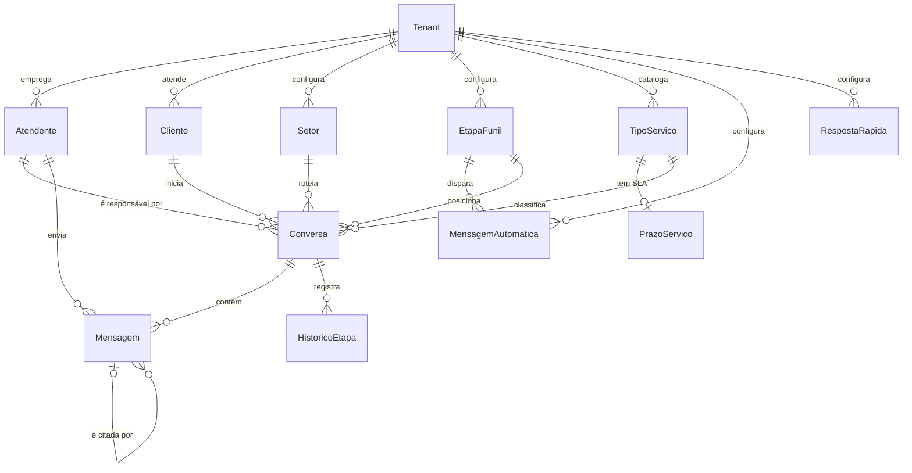

# MODELO DE DADOS

> **Status:** aprovado para a Fase 1 e implementado. Ampliado pela Fase 2
> (piloto não oficial) — ver marcações "Fase 2A/2B/2C/2D/2E/2H/2I/2K" nas
> seções abaixo.
> **Última atualização:** 2026-09-22 — `Tenant.MensagensAutomaticasHabilitadas`
> e `Tenant.RespostaInteligenteHabilitada` (chaves gerais pela tela, `sql/049`).
> Antes, 2026-09-12 — blindagem LGPD PR3: colunas cifradas em
> repouso marcadas onde aparecem (Cliente, Conversa, Mensagem, HistoricoEtapa);
> `Cliente.DocumentoHash`/`DataNascimentoCifrada` novas. Ver
> [PROTECAO-DE-DADOS.md](PROTECAO-DE-DADOS.md).
>
> DDL correspondente em [`sql/001-schema.sql`](../sql/001-schema.sql).
> Os scripts aprovados foram aplicados somente em `CRM_Cartorio_Dev`. Nenhum
> script foi executado em produção.

---

## 1. Visão geral



Leitura em uma frase: **um cliente inicia uma conversa no WhatsApp do cartório;
essa conversa é assumida por um atendente, roteada para um setor, avança por
etapas de funil, acumula mensagens identificadas por autor, e ao final é
encerrada — nunca apagada.**

---

## 2. Dois eixos independentes

Erro clássico neste domínio é fundir setor e etapa numa coluna só. São coisas
diferentes:

| | **Setor** | **EtapaFunil** |
| --- | --- | --- |
| Responde | *quem* atende | *em que ponto* está |
| Uso | roteamento | progressão |
| Muda quando | a demanda é de outra área | o atendimento avança |
| Exemplo | Tabelionato de Notas | Em processamento / exigência |

Uma conversa pode trocar de setor sem avançar de etapa (roteamento errado) e
avançar de etapa sem trocar de setor (caso normal). Por isso são duas FKs
separadas em `Conversa` e um histórico único que registra as duas dimensões.

Ambas são **tabelas configuráveis por tenant**. Nada de enum fixo em código:
o cartório parceiro precisa poder renomear e reordenar pela tela.

---

## 3. Entidades

Convenções aplicadas a todas as tabelas de negócio:

- PK `Id` do tipo `uniqueidentifier` (Guid v7 sequencial, gerado na aplicação).
- `TenantId` obrigatório — presente desde a Fase 1 mesmo com um tenant só.
  Retrofit de multi-tenancy depois seria caro e arriscado.
- `CriadoEm` / `AtualizadoEm` em `datetime2(3)`, UTC.
- Desativação por flag `Ativo`. **Não existe DELETE físico no código.**

### 3.1 Tenant

Cartório cliente. Na Fase 1 existe um registro; a estrutura já é multi-tenant.

| Campo | Tipo | Obrig. | Observação |
| --- | --- | --- | --- |
| Id | Guid | sim | PK |
| RazaoSocial | string(200) | sim | |
| NomeFantasia | string(200) | não | |
| Cnpj | string(14) | sim | Só dígitos. Único |
| WhatsappBusinessAccountId | string(64) | não | WABA ID — preenchido na Fase 2 |
| WhatsappPhoneNumberId | string(64) | não | Phone Number ID da Cloud API — Fase 2 |
| WhatsappNumeroExibicao | string(20) | não | Número em formato E.164, exibição |
| WhatsappInstancia | string(120) | não | Nome único da instância Evolution pareada; roteia webhook ao tenant |
| MinutosParaPerguntarEncerramento | int | não | **Fase 2H.** Minutos de silêncio até perguntar se pode encerrar. Nulo = recurso desligado |
| MinutosParaEncerrarSemResposta | int | não | **Fase 2H.** Minutos após a pergunta até encerrar sem resposta. Nulo = recurso desligado |
| EncerramentoHoraInicial | int | não | **Fase 2H.** Hora (0–23) inicial da janela em que a pergunta pode sair. Nulo = qualquer hora |
| EncerramentoHoraFinal | int | não | **Fase 2H.** Hora (0–23) final da janela. Nulo = qualquer hora |
| MensagensAutomaticasHabilitadas | bool | sim | **`sql/049`, 2026-09-22.** Chave geral de todas as mensagens automáticas, inclusive o bot de triagem. `DEFAULT (1)` |
| RespostaInteligenteHabilitada | bool | sim | **`sql/049`, 2026-09-22.** Chave geral da IA pela tela — substitui `RespostaInteligente:Habilitada` do appsettings. `DEFAULT (1)` |
| Ativo | bool | sim | |
| CriadoEm / AtualizadoEm | datetime2(3) | sim | |

Os quatro campos de encerramento automático seguem a mesma convenção de
`WhatsappModoDeRecebimento`: nulo é estado deliberado ("ninguém decidiu
isso ainda" ou "desligado"), não zero disfarçado. Os dois minutos são
tudo-ou-nada (ambos nulos ou ambos preenchidos), assim como as duas horas —
validado em `TenantService`. Comportamento completo em
[FLUXO-AUTOMACAO.md](FLUXO-AUTOMACAO.md) §10.

As duas chaves gerais são `bool` não nulo, ao contrário dos campos de
encerramento: não existe "ninguém decidiu" aqui — nascer ligada é exatamente o
comportamento de antes da coluna existir. Desligar não apaga cadastro nenhum;
granularidade por regra continua em `MensagemAutomatica.Ativo`. Comportamento
completo em [FLUXO-AUTOMACAO.md](FLUXO-AUTOMACAO.md) §1.1.

Os três campos de conta/número oficial são o ponto de encaixe da Cloud API e
ficam nulos no piloto não oficial. `WhatsappInstancia` já é usado pela Evolution:
uma instância pertence a um tenant e é preenchida pela tela de pareamento, sem
SQL manual. Produção e teste usam nomes de instância diferentes.

**Dados da serventia que o modelo ainda não guarda:** CNS, endereço, horário de
funcionamento e jurisdição. Estão em [CONTEXTO.md](CONTEXTO.md), seção 2, e no
cabeçalho de [`sql/002-seed-simulado.sql`](../sql/002-seed-simulado.sql). Entram
no banco quando houver tela de configuração da serventia — não é escopo da Fase 1,
e adicionar coluna que nenhuma tela preenche é peso morto.

### 3.2 Atendente

Usuário do sistema — funcionário da serventia.

| Campo | Tipo | Obrig. | Observação |
| --- | --- | --- | --- |
| Id | Guid | sim | PK |
| TenantId | Guid | sim | FK → Tenant |
| Nome | string(150) | sim | Exibido junto de cada mensagem enviada |
| Email | string(160) | sim | Login. Único por tenant |
| SenhaHash | string(500) | sim | PBKDF2 + salt por usuário. Nunca texto claro |
| Perfil | enum | sim | **Permissão no sistema.** `Administrador` / `Supervisor` / `Atendente` |
| Cargo | enum | sim | **Função na serventia.** Ver abaixo. Nasce `NaoInformado` |
| SetorPadraoId | Guid | não | FK → Setor. Pré-seleção na triagem |
| Ativo | bool | sim | Desligamento corta acesso sem apagar histórico |
| UltimoAcessoEm | datetime2(3) | não | |
| CriadoEm / AtualizadoEm | datetime2(3) | sim | |

Perfis (a validar — [REQUISITOS.md](REQUISITOS.md) §5, pendência 7):

| Perfil | Pode |
| --- | --- |
| Atendente | Assumir conversa livre, responder a sua, liberar a sua, mover etapa/setor da sua, encerrar a sua |
| Supervisor | Tudo do atendente + transferir conversa de terceiro + reabrir + gerir cadastros |
| Administrador | Tudo do supervisor + gerir atendentes |

#### Cargo e perfil são eixos independentes

As duas coisas estavam fundidas numa coluna só e foram separadas. Não são a mesma
pergunta:

| | `Cargo` | `Perfil` |
| --- | --- | --- |
| Responde | o que a pessoa **é** no cartório | o que a pessoa **pode fazer** no sistema |
| Origem | estrutura da Lei 8.935/94 | decisão do administrador |
| Existe fora do software | sim | não |
| Concede acesso | **não** | sim |

| Cargo | Valor |
| --- | --- |
| `NaoInformado` | 0 |
| `Titular` | 1 |
| `Substituto` | 2 |
| `EscreventeAutorizado` | 3 |
| `Escrevente` | 4 |
| `Auxiliar` | 5 |

Fundidos, um escrevente não podia receber permissão de supervisão sem aparecer como
"Supervisor" — cargo que não existe em cartório —, e o titular não podia ter acesso
restrito sem parecer rebaixado na tela. No seed, Carla Menezes é o exemplo:
`EscreventeAutorizado` de cargo, `Supervisor` de perfil.

**Enum, não tabela**, pela mesma regra do gatilho de mensagem: os cargos vêm da lei
de delegação, não da preferência do cartório. O que é configurável por tenant é quem
ocupa cada um — isso se faz pela tela de Atendentes.

### 3.3 Cliente

Contato final que manda mensagem. **Não é usuário do sistema.**

| Campo | Tipo | Obrig. | Observação |
| --- | --- | --- | --- |
| Id | Guid | sim | PK |
| TenantId | Guid | sim | FK → Tenant |
| Nome | string(200) | sim | Nome do perfil do WhatsApp até ser corrigido |
| Tipo | enum | sim | `Fisica` / `Juridica` |
| TelefoneWhatsapp | string(20) | sim | E.164, só dígitos. **Único por tenant** |
| TelefoneAlternativo | string(20) | não | Telefone fixo ou de recado. Cifrado em repouso (PR3) |
| Documento | string(14) | não | CPF/CNPJ, conforme `Tipo`. **Cifrado em repouso (PR3)** quando a cifra estiver ativa — ver `DocumentoHash` |
| DocumentoHash | char(64) | não | **PR3, 2026-09-12.** Índice cego (HMAC) de `Documento`, só dígitos — sustenta busca por igualdade exata quando a cifra está ativa; nulo enquanto dormente ou sem documento |
| Email | string(160) | não | Cifrado em repouso (PR3) |
| Rg / OrgaoEmissor / UfOrgaoEmissor | string | não | Identidade de pessoa física. Cifrados em repouso (PR3) |
| DataNascimento | date | não | **Coluna órfã desde PR3 (2026-09-12)** — o campo `Cliente.DataNascimento` do código passou a ler/gravar `DataNascimentoCifrada` (nova, abaixo); esta coluna original fica no banco sem ninguém ler, até uma migração de limpeza futura |
| DataNascimentoCifrada | string (nvarchar(max)) | não | **PR3.** Data em ISO (`yyyy-MM-dd`), cifrada — é o que `Cliente.DataNascimento` de fato usa hoje |
| EstadoCivil | enum | sim | Valor neutro `NaoInformado` quando ainda não coletado |
| RegimeDeBens | enum | sim | Só permanece preenchido quando `EstadoCivil = Casado` |
| Profissao / Nacionalidade / Naturalidade | string | não | Qualificação da parte. Cifrados em repouso (PR3) |
| NomeDoPai / NomeDaMae | string(200) | não | Filiação. Cifrados em repouso (PR3) |
| RazaoSocial | string(200) | não | Pessoa jurídica — fica em claro (busca "contém" do balcão) |
| RepresentanteLegal | string(200) | não | Pessoa jurídica. Cifrado em repouso (PR3) |
| Cep / Logradouro / Numero / Complemento | string | não | Endereço. Cifrados em repouso (PR3) |
| Bairro | string | não | Endereço. Cifrado em repouso (PR3) |
| Cidade / Uf | string | não | Endereço — ficam em claro (filtro de listagem, geografia grosseira) |
| Observacoes | string(1000) | não | Cifrado em repouso (PR3) |
| FotoPerfilUrl | string(500) | não | URL da foto de perfil no WhatsApp (temporária) |
| FotoPerfilAtualizadaEm | datetime2(3) | não | Instante UTC da última consulta/atualização |
| NomePerguntadoEm | datetime2(3) | não | **Fase 2I.** Quando o sistema perguntou a este contato como quer ser chamado. Fato datado, não estado — serve a uma coisa só: não perguntar duas vezes |
| OrigemDoCadastro | enum | não | De onde este cadastro veio: `Webhook` / `Manual` / `ImportacaoPlanilha` / `ImportacaoWhatsapp`. Nulo nos clientes anteriores à coluna — "não sabemos" é a verdade para eles, sem backfill retroativo |
| PrimeiroContatoEm | datetime2(3) | sim | |
| Ativo | bool | sim | |
| CriadoEm / AtualizadoEm | datetime2(3) | sim | |

O telefone é a identidade real do cliente — é por ele que a mensagem chega. Por
isso é único por tenant e não pode ser nulo. Documento é opcional de propósito:
exigir CPF no primeiro "bom dia" trava o atendimento.

**`Nome` guarda o que veio do perfil do WhatsApp, inclusive quando não presta.**
Perfil em `"."` ou emoji entra assim mesmo — não se destrói dado de origem. Se
o nome serve para se dirigir ao cliente é decidido **na leitura**, por
`NomeDeContato.EhUtil` (mesmo princípio de `PercentualDeQualificacao`), e é isso
que o painel usa para mostrar o telefone no lugar e que as mensagens automáticas
usam para omitir o vocativo. Comportamento completo em
[FLUXO-AUTOMACAO.md](FLUXO-AUTOMACAO.md) §11.

Os demais dados também são opcionais pela mesma razão. A interface mostra um
**percentual de qualificação calculado na leitura**, nunca persistido: o indicador
orienta o atendente sobre o que ainda falta sem transformar o primeiro contato
num formulário obrigatório. Pessoa física considera documento, RG, profissão,
nacionalidade, naturalidade, filiação, nascimento, estado civil e endereço;
pessoa jurídica considera CNPJ, razão social, representante, contato e endereço.

### 3.4 Setor

Área da serventia. Configurável.

| Campo | Tipo | Obrig. | Observação |
| --- | --- | --- | --- |
| Id | Guid | sim | PK |
| TenantId | Guid | sim | FK → Tenant |
| Nome | string(120) | sim | Único por tenant |
| Descricao | string(300) | não | |
| Ordem | int | sim | Ordenação na interface |
| Ativo | bool | sim | Desativar não afeta conversa histórica |
| CriadoEm / AtualizadoEm | datetime2(3) | sim | |

**Setores semeados — dois, e são dado confirmado**, não sugestão: espelham as
atribuições da serventia no CNJ ([CONTEXTO.md](CONTEXTO.md), seção 2.2).

| Ordem | Nome |
| --- | --- |
| 1 | Tabelionato de Notas |
| 2 | Registro Civil |

### 3.5 EtapaFunil

Estágio da conversa. Configurável e ordenável.

| Campo | Tipo | Obrig. | Observação |
| --- | --- | --- | --- |
| Id | Guid | sim | PK |
| TenantId | Guid | sim | FK → Tenant |
| Nome | string(120) | sim | Único por tenant |
| Descricao | string(300) | não | |
| Ordem | int | sim | Define a sequência do funil |
| Cor | string(9) | sim | Hex `#RRGGBB`, para o quadro |
| EhFinal | bool | sim | Marca a etapa que representa conclusão |
| Ativo | bool | sim | |
| CriadoEm / AtualizadoEm | datetime2(3) | sim | |

**Etapas semeadas na demonstração** (sugestão de mercado, a validar):

| Ordem | Nome | EhFinal |
| --- | --- | --- |
| 1 | Atendimento inicial | não |
| 2 | Captação do serviço | não |
| 3 | Em processamento / exigência | não |
| 4 | Pronto / entrega | **sim** |

### 3.6 TipoServico

Catálogo de atos cartorários. Configurável.

| Campo | Tipo | Obrig. | Observação |
| --- | --- | --- | --- |
| Id | Guid | sim | PK |
| TenantId | Guid | sim | FK → Tenant |
| Nome | string(160) | sim | Único por tenant |
| Codigo | string(30) | não | Código interno do cartório |
| Categoria | enum | sim | `Notas`, `RegistroCivil`, `RegistroImoveis`, `TitulosDocumentos`, `Protesto`, `Outros` |
| Descricao | string(500) | não | |
| SetorId | Guid | não | FK → Setor, `Restrict`. **Fase 2D.** Habilita o serviço no menu de 2º nível da triagem automática (`{MenuServicos}`). Nulo de propósito para serviço `AGUARDANDO CONFIRMAÇÃO` de atribuição — sem `SetorId`, não entra em nenhum menu automático |
| DocumentosNecessarios | string(800) | não | **Fase 2D.** Checklist em texto livre, cadastrável pela tela. Preenche `{DocumentosNecessarios}` |
| Ativo | bool | sim | |
| CriadoEm / AtualizadoEm | datetime2(3) | sim | |

**Catálogo semeado — 10 atos, apenas das duas atribuições da serventia**
([CONTEXTO.md](CONTEXTO.md), seção 2.2):

| Categoria | Atos |
| --- | --- |
| `RegistroCivil` | Certidão de nascimento, de casamento, de óbito, segunda via de certidão |
| `Notas` | Reconhecimento de firma, autenticação de documento, escritura pública de compra e venda, escritura pública de doação, procuração pública |
| `Outros` | Notificação extrajudicial — **`AGUARDANDO CONFIRMAÇÃO`** na descrição |

**Removidos** por não serem atribuição deste cartório: registro de imóvel,
averbação em matrícula, certidão de matrícula, certidão de ônus reais.

A **escritura** de compra e venda permanece: lavrar escritura é ato do tabelião
de notas. O que corre em outra serventia é o **registro** dessa escritura na
matrícula, no Registro de Imóveis.

O enum `CategoriaServico` mantém os valores `RegistroImoveis`,
`TitulosDocumentos` e `Protesto`. Ficam sem uso: são categorias válidas do
domínio cartorário em geral, e removê-las do enum quebraria a leitura de dado
já gravado quando o sistema for usado por uma serventia de ofício único.

### 3.7 PrazoServico

SLA de um tipo de serviço. Relação **1:1** com `TipoServico`.

| Campo | Tipo | Obrig. | Observação |
| --- | --- | --- | --- |
| Id | Guid | sim | PK |
| TenantId | Guid | sim | FK → Tenant |
| TipoServicoId | Guid | sim | FK → TipoServico. **Único** |
| PrazoHoras | int | sim | Duração do SLA em horas |
| PercentualAlerta | int | sim | 1–99. Alerta ao consumir esse % do prazo |
| ApenasDiasUteis | bool | sim | Se `true`, o cálculo pula sábado e domingo |
| Ativo | bool | sim | |
| CriadoEm / AtualizadoEm | datetime2(3) | sim | |

Prazo em **horas**, não dias, porque a faixa é larga: reconhecimento de firma sai
em minutos, registro de imóvel leva dias. Hora é a menor unidade que cobre os dois
sem virar dois campos.

**Situação de prazo** é calculada na leitura, nunca persistida:

| Situação | Regra |
| --- | --- |
| `SemPrazo` | `Conversa.PrazoLimite` nulo |
| `EmDia` | agora < `Conversa.PrazoAlertaEm` |
| `EmAlerta` | agora ≥ `PrazoAlertaEm` e agora ≤ `PrazoLimite` |
| `Atrasada` | agora > `PrazoLimite` |

Persistir a **situação** exigiria job de atualização e mentiria entre as
execuções. Já os dois **instantes** (`PrazoLimite` e `PrazoAlertaEm`) são
gravados na conversa quando o serviço é vinculado — são datas fixas, não estado
que envelhece.

Isso é o que torna o filtro de prazo da inbox uma comparação de datas em SQL,
indexável, em vez de uma subconsulta de percentual por linha. Conversa encerrada
congela a avaliação em `EncerradaEm`: mostrar "atrasada" para atendimento já
entregue só polui o painel.

### 3.8 Conversa

Entidade central. É onde mora a trava.

| Campo | Tipo | Obrig. | Observação |
| --- | --- | --- | --- |
| Id | Guid | sim | PK |
| TenantId | Guid | sim | FK → Tenant |
| ClienteId | Guid | sim | FK → Cliente |
| Protocolo | string(20) | sim | **Único por tenant.** Formato `AAAAMM-NNNN` |
| AtendenteId | Guid | não | FK → Atendente. **Nulo = na fila. Preenchido = travada** |
| EmAtendimentoHumano | bool | sim | **`sql/028`, 2026-08-26 (BUG-ATD-01).** A conversa já foi entregue a um humano neste ciclo — liga ao pedir/assumir atendente, só desliga no encerramento. **Não é o mesmo que `AtendenteId != null`**: continua ligado depois de `LiberarAsync` (fila humana). Único campo que o despacho de mensagem consulta antes de decidir chamar automação — ver FLUXO-AUTOMACAO.md §1 e §5 |
| SetorId | Guid | não | FK → Setor |
| EtapaId | Guid | não | FK → EtapaFunil |
| TipoServicoId | Guid | não | FK → TipoServico. Preenchido na captação |
| Status | enum | sim | `Ativa` / `Encerrada` |
| Canal | enum | sim | `Simulado` na Fase 1, `WhatsApp` na Fase 2 |
| IniciadaEm | datetime2(3) | sim | |
| UltimaMensagemEm | datetime2(3) | sim | Ordenação da inbox |
| MensagensNaoLidas | int | sim | Mensagens do cliente ainda não lidas |
| AguardandoTriagem | bool | sim | Recebeu o menu de setor e espera a escolha (nível 1). Ver [FLUXO-AUTOMACAO.md](FLUXO-AUTOMACAO.md) |
| AguardandoEscolhaDeServico | bool | sim | **Fase 2D.** Setor reconhecido, espera a escolha do serviço (nível 2) |
| AguardandoRespostaInteligente | bool | sim | **Fase 2B.** A IA respondeu e a próxima mensagem do cliente volta para ela, em vez de escalar direto |
| TentativasRespostaInteligente | int | sim | **Fase 2B.** Contador de respostas seguidas da IA nesta sequência. Telemetria — nenhuma decisão de escalonamento lê este número (removido em 2026-08-17, ver FLUXO-AUTOMACAO.md §8) |
| AguardandoMenuDeContinuacao | bool | sim | **Fase 2E.** Atendimento estruturado terminou; espera a escolha entre continuar, trocar de setor, falar com atendente ou encerrar |
| AguardandoNome | bool | sim | **Fase 2I.** O contato chegou sem nome utilizável no perfil e a conversa espera que ele diga como quer ser chamado, antes do menu. Dura uma mensagem, como as demais |
| PerguntaDeEncerramentoEnviadaEm | datetime2(3) | não | **Fase 2H.** Instante em que a pergunta "posso encerrar?" saiu. Marcador idempotente da fase 1, relógio da fase 2 **e** flag de despacho da próxima resposta do cliente — os três papéis no mesmo campo, de propósito (ver FLUXO-AUTOMACAO.md §10) |
| PrazoIniciadoEm | datetime2(3) | não | Marcado ao vincular o tipo de serviço |
| PrazoLimite | datetime2(3) | não | Calculado por `PrazoServico` |
| PrazoAlertaEm | datetime2(3) | não | Instante em que entra em alerta. Derivado do percentual, ver nota |
| AvisoDeAlertaEnviadoEm | datetime2(3) | não | Quando o aviso de prazo perto de vencer saiu |
| AvisoDeVencimentoEnviadoEm | datetime2(3) | não | Quando o aviso de prazo vencido saiu |
| EncerradaEm | datetime2(3) | não | |
| EncerradaPorAtendenteId | Guid | não | FK → Atendente |
| MotivoEncerramento | string(500) | não | Opcional (pendência 10). Cifrado em repouso (PR3) |
| ReabertaEm | datetime2(3) | não | |
| ReabertaPorAtendenteId | Guid | não | FK → Atendente |
| **RowVersion** | rowversion | sim | **Concorrência otimista** |
| CriadoEm / AtualizadoEm | datetime2(3) | sim | |

**Não existe coluna de exclusão.** Encerrar muda `Status` para `Encerrada` e a
conversa sai da lista ativa — o conteúdo permanece íntegro e consultável. Foi
pedido explicitamente pelo cliente (RF-015).

**Os dois `AvisoDe…EnviadoEm` não contradizem a regra de não persistir situação de
prazo.** O que fica gravado não é *"está em alerta"* — isso envelhece e mentiria
entre duas leituras — e sim *"o aviso saiu"*, que é fato datado e não muda mais.
São eles que tornam o disparo idempotente: a varredura roda a cada poucos minutos e
reencontraria a mesma conversa em alerta a cada volta.

### 3.9 Mensagem

| Campo | Tipo | Obrig. | Observação |
| --- | --- | --- | --- |
| Id | Guid | sim | PK |
| TenantId | Guid | sim | FK → Tenant |
| ConversaId | Guid | sim | FK → Conversa |
| AutorTipo | enum | sim | `Cliente` / `Atendente` / `Sistema` |
| AtendenteId | Guid | não | FK → Atendente. **Obrigatório quando `AutorTipo = Atendente`** |
| Conteudo | string(4000) | sim | Cifrado em repouso (PR3) — nvarchar(max) na coluna física |
| Tipo | enum | sim | `Texto` na Fase 1; `Imagem`/`Documento`/`Audio`/`Video` desde a Fase 2C |
| StatusEntrega | enum | sim | `Pendente` / `Enviada` / `Entregue` / `Lida` / `Falha` |
| EhAutomatica | bool | sim | Gerada por regra ou pela IA, não escrita por gente. Ver abaixo |
| GeradaPorIa | bool | sim | **Fase 2B.** A mensagem automática veio da Resposta Inteligente, não de uma regra de `MensagemAutomatica` cadastrada. Sempre acompanha `EhAutomatica = true`; separa o rótulo "IA" do rótulo "Automática" na tela |
| EnviadaEm | datetime2(3) | sim | |
| LidaEm | datetime2(3) | não | |
| IdExternoWhatsapp | string(80) | não | ID da Meta — Fase 2 |
| MensagemRespondidaId | Guid | não | Auto-FK → Mensagem citada na resposta |
| CriadoEm | datetime2(3) | sim | |

`AtendenteId` é o requisito RF-007 na sua forma mais literal: o cliente pediu para
saber **qual atendente respondeu**, e a resposta é uma coluna, não uma inferência.
A regra "atendente exige `AtendenteId`" é validada no serviço e reforçada por
`CHECK` no banco.

Mensagem `Sistema` registra evento no fio da conversa ("Conversa assumida por
Fulano", "Etapa alterada para X"), o que dá contexto ao próximo atendente sem
precisar abrir uma aba de histórico.

`EhAutomatica` divide esse `Sistema` em dois, e a diferença muda tudo na tela:

| `AutorTipo` | `EhAutomatica` | O que é | Como aparece |
| --- | --- | --- | --- |
| `Sistema` | `false` | Anotação interna. O cliente nunca receberia | Texto à margem, centralizado |
| `Sistema` | `true` | Mensagem **endereçada ao cliente** | Balão do lado da serventia, com o rótulo "Automática" |

Sem essa coluna as duas seriam indistinguíveis no banco, e o atendente veria uma
frase dirigida ao cliente achando que um colega a escreveu. `CHECK` no banco impede
`EhAutomatica = 1` fora de `AutorTipo = Sistema`.

Na Fase 1 a mensagem automática nasce em `Pendente` — é o único estado honesto, já
que não há WhatsApp conectado para entregar nada. Na Fase 2, o retorno da Graph API
promove para `Enviada` e o webhook de status para `Entregue`/`Lida`, sem que a
lógica de geração mude.

Ao responder, o banco guarda somente `MensagemRespondidaId`. Autor e prévia do
texto citado são resolvidos na leitura; copiar o texto para a resposta criaria
duas versões da mesma mensagem. O serviço exige que a mensagem citada pertença
à mesma conversa e ao mesmo tenant.

Os cinco estados de entrega já existem na Fase 1. `Enviada` é o estado inicial
da resposta simulada; quando se simula uma nova mensagem do cliente, as respostas
anteriores são promovidas a `Lida` para demonstrar os tiques. `Entregue` e `Lida`
reais só serão verdadeiros quando o webhook de status da Meta entrar na Fase 2.

### 3.10 HistoricoEtapa

Trilha de mudanças de etapa e setor. **Só cresce — nunca editado, nunca apagado.**

| Campo | Tipo | Obrig. | Observação |
| --- | --- | --- | --- |
| Id | Guid | sim | PK |
| TenantId | Guid | sim | FK → Tenant |
| ConversaId | Guid | sim | FK → Conversa |
| TipoMudanca | enum | sim | `Abertura` / `Etapa` / `Setor` / `EtapaESetor` |
| EtapaAnteriorId | Guid | não | FK → EtapaFunil |
| EtapaNovaId | Guid | não | FK → EtapaFunil |
| SetorAnteriorId | Guid | não | FK → Setor |
| SetorNovoId | Guid | não | FK → Setor |
| AtendenteId | Guid | não | FK → Atendente. Nulo = automático |
| OcorridoEm | datetime2(3) | sim | |
| Observacao | string(500) | não | Cifrado em repouso (PR3) |

### 3.11 MensagemAutomatica

Modelo de mensagem que o sistema envia sozinho quando um evento acontece.
Configurável, no mesmo padrão de `Setor` e `EtapaFunil`.

| Campo | Tipo | Obrig. | Observação |
| --- | --- | --- | --- |
| Id | Guid | sim | PK |
| TenantId | Guid | sim | FK → Tenant |
| Gatilho | enum | sim | Ver tabela abaixo |
| EtapaAlvoId | Guid | não | FK → EtapaFunil. **Obrigatório com `EtapaAlterada`, nulo nos demais** |
| Conteudo | string(1000) | sim | Modelo com marcadores |
| Ativo | bool | sim | Desativar para de disparar; não apaga o que já saiu |
| CriadoEm / AtualizadoEm | datetime2(3) | sim | |

| Gatilho | Quando dispara | Quem provoca |
| --- | --- | --- |
| `NovoAtendimento` | Conversa aberta **sem setor definido** | `ConversaService.CriarAsync`, `AplicadorDePosAtendimento` (reabertura por "menu") |
| `EtapaAlterada` | Conversa entra na etapa alvo | `ConversaService.MoverAsync` |
| `PrazoProximoVencimento` | `agora ≥ PrazoAlertaEm` e ainda dentro do prazo | Varredura periódica |
| `PrazoVencido` | `agora > PrazoLimite` | Varredura periódica |
| `TriagemSemCorrespondencia` | Resposta ao menu de setor não bate com nenhuma opção | `AplicadorDeTriagem`, `AplicadorDeRespostaInteligente` |
| `TriagemComCorrespondencia` | **Fase 2D.** Setor reconhecido e com ≥1 serviço vinculado — pergunta qual serviço | `AplicadorDeTriagem`, `AplicadorDePosAtendimento` |
| `ServicoEscolhido` | **Fase 2D.** Cliente escolheu o serviço no menu de 2º nível | `AplicadorDeEscolhaDeServico` |
| `MenuDeContinuacao` | **Fase 2E.** Atendimento estruturado terminou — oferece continuar, trocar de setor, falar com atendente ou encerrar | `AplicadorDeEscolhaDeServico` |
| `PedidoDeAtendente` | **Fase 2E.** Encaminha para atendente no meio/fim do atendimento (setor já definido) — texto diferente de `TriagemSemCorrespondencia` | `AplicadorDeRespostaInteligente`, `AplicadorDePosAtendimento` |
| `Despedida` | **Fase 2E.** Cliente escolheu encerrar pelo menu de continuação — envia a despedida e fecha a conversa (`Status = Encerrada`) | `AplicadorDePosAtendimento` |
| `RespostaSemCorrespondencia` | **Fase 2G.** A IA não achou resposta no catálogo e o cliente não pediu atendente | `AplicadorDeRespostaInteligente` |
| `ConfirmacaoDeEncerramento` | **Fase 2H.** Conversa de WhatsApp real parada há `Tenant.MinutosParaPerguntarEncerramento` | `VarredorDeInatividade` (fase 1) |
| `EncerramentoPorInatividade` | **Fase 2H.** Sem resposta à pergunta acima dentro de `Tenant.MinutosParaEncerrarSemResposta` | `VarredorDeInatividade` (fase 2) |
| `PedidoDeNome` | **Fase 2I.** Contato chegou sem nome utilizável no perfil do WhatsApp — pergunta antes das boas-vindas | `RecebimentoDeWhatsApp` |
| `EncerramentoPeloAtendente` | **Fase 2K.** Atendente encerrou pelo painel — avisa o cliente. Cortesia, não condição, como `EncerramentoPorInatividade`; não reusa `Despedida` (quem fechou foi a serventia, não o cliente) | `ConversaService.EncerrarAsync`, e só ele |

Comportamento completo de cada gatilho — a máquina de estado, quando a IA
entra, quando escala — em [FLUXO-AUTOMACAO.md](FLUXO-AUTOMACAO.md). Esta
seção descreve só o schema.

**Por que gatilho é enum e o resto é cadastro.** Cada gatilho corresponde a um ponto
de código que precisa existir para disparar — gatilho novo exige release. Já o
**texto** e **qual etapa** dispara são linhas de tabela: nenhuma frase que o cliente
final lê deveria exigir alteração de código para mudar.

**Por que `EtapaAlvoId` não aceita nulo no gatilho de etapa.** Uma regra "qualquer
etapa" enviaria mensagem ao cliente em toda movimentação interna do funil — o oposto
do que se quer. `CHECK` no banco garante os dois lados da regra.

**Marcadores aceitos no conteúdo**, resolvidos no instante do disparo:

| Marcador | Vira |
| --- | --- |
| `{NomeCliente}` | Nome do cliente no cadastro |
| `{NomeCartorio}` | `Tenant.NomeFantasia`, ou a razão social quando nulo |
| `{Servico}` | `TipoServico.Nome`, ou `"não informado"` quando ainda não captado |
| `{Protocolo}` | `Conversa.Protocolo` |
| `{MenuSetores}` | Lista numerada dos setores **ativos**, montada no disparo |
| `{MenuServicos}` | **Fase 2D.** Lista numerada dos serviços **ativos** do setor da conversa (`TipoServico.SetorId`) |
| `{DocumentosNecessarios}` | **Fase 2D.** Checklist do `TipoServico` vinculado, ou `"a confirmar com o atendente"` |
| `{PrazoServico}` | **Fase 2D.** Prazo do `TipoServico` vinculado, formatado (`"até 15 dias úteis"`), ou `"a confirmar com o atendente"` |

Marcador fora dessa lista é **recusado no salvamento**. É a única chance de pegar o
erro: um `{NomeClinte}` digitado errado não estouraria em lugar nenhum — sairia
literal na mensagem que o cliente do cartório lê.

`{MenuSetores}` e `{MenuServicos}` são o que torna os dois níveis do menu de
triagem cadastro e não código: adicionar, desativar ou vincular um setor/serviço
muda o menu sozinho, sem tocar no texto da mensagem. Os dois usam a mesma
numeração que `TriagemAutomatica.InterpretarResposta` espera de volta.

### 3.12 RespostaRapida

Texto pronto que o atendente insere no campo digitando `/atalho`.

| Campo | Tipo | Obrig. | Observação |
| --- | --- | --- | --- |
| Id | Guid | sim | PK |
| TenantId | Guid | sim | FK → Tenant |
| Atalho | string(30) | sim | Sem a barra, minúsculo, sem espaço. **Único por tenant** |
| Titulo | string(120) | sim | Rótulo na lista do seletor |
| Conteudo | string(1000) | sim | Aceita os mesmos marcadores de 3.11 |
| Ativo | bool | sim | Desativada some do seletor sem sair do cadastro |
| CriadoEm / AtualizadoEm | datetime2(3) | sim | |

**Não é mensagem automática.** Nada sai daqui sozinho: o atalho preenche o campo, o
atendente lê, edita se quiser e envia. As duas entidades parecem iguais no banco —
um texto com marcadores — e são opostas na responsabilidade: a de 3.11 o sistema
assina, esta o atendente assina. É por isso que o `AtendenteId` da mensagem
resultante continua sendo o dele, e o RF-007 continua valendo.

### 3.13 ChamadaDeIa

Uma linha por **tentativa** de chamada a um provedor de IA (Gemini ou
Anthropic) — nunca conteúdo de mensagem, dado do cliente, chave ou trecho de
prompt, só metadado técnico. Ver [FLUXO-AUTOMACAO.md §8](FLUXO-AUTOMACAO.md).

| Campo | Tipo | Obrig. | Observação |
| --- | --- | --- | --- |
| Id | Guid | sim | PK |
| TenantId | Guid | sim | FK → Tenant |
| ConversaId | Guid | não | Nula quando a chamada não é de uma conversa específica (ex.: sonda do disjuntor) |
| ChaveDeProjeto | string(16) | não | Fingerprint (SHA-256) da chave do Gemini — nunca a chave. Nula para Anthropic |
| Provedor | tinyint | sim | 1 Gemini, 2 Anthropic |
| Modelo | string(60) | sim | |
| IniciadaEm | datetime2(3) | sim | |
| LatenciaMs | int | sim | |
| Sucesso | bool | sim | A tentativa produziu resposta do modelo — inclui `podeResponder=false`, que é resultado válido |
| PodeResponder | bool | não | Só preenchido quando `Sucesso=true` |
| TipoDeFalha | tinyint | sim | 0 Nenhuma .. 7 RespostaInvalida — ver `TipoDeFalhaDeIa` |
| CodigoHttp | int | não | |
| MotivoDoFallback | string(200) | não | Preenchido só nas tentativas de fallback (Anthropic, quando o Gemini falhou ou foi pulado) |
| FoiFallback | bool | sim | |
| TokensEntrada / TokensSaida / TokensPensamento | int | sim | |
| CustoEstimadoUsd | decimal(10,6) | não | Sempre nulo para o Gemini (gratuito dentro da franquia) |
| NivelDeRaciocinio | string(10) | não | `low`/`medium`/`high` — só Gemini |
| CriadoEm / AtualizadoEm | datetime2(3) | sim | |

**Sem FK para Conversa** de propósito: uma sonda do disjuntor pode não ter
conversa nenhuma, e o log de observabilidade não pode travar nenhuma rotina de
manutenção futura sobre `Conversas`. Gravada num `DbContext` próprio,
independente da transação de negócio da requisição — sobrevive a rollback e a
falha total (os dois provedores caindo, sem `Mensagem` nenhuma criada).

---

## 4. Trava de conversa

Requisito técnico crítico (RF-009, RF-010, RF-011). Duplicidade de resposta é o
erro mais citado no mercado. Três mecanismos em camadas:

### 4.1 UPDATE condicional — a garantia real

Assumir conversa não é `SELECT` seguido de `UPDATE`. É um `UPDATE` único com a
condição no `WHERE`:

```sql
UPDATE Conversas
   SET AtendenteId = @atendente, AtualizadoEm = @agora
 WHERE Id = @id
   AND TenantId = @tenant
   AND AtendenteId IS NULL
   AND Status = 1;          -- Ativa
```

Se afetar **0 linhas**, outro atendente chegou primeiro. O serviço então relê a
conversa e devolve `ConflitoDeAtribuicaoException` com o **nome de quem assumiu** —
conflito tratável, com mensagem útil, não erro 500.

Isso resolve a corrida de verdade: a atomicidade é do banco, não de um `lock` do
processo. Funciona com múltiplas instâncias de IIS.

### 4.2 `rowversion` — proteção das demais escritas

`Conversa.RowVersion` é `rowversion` mapeado como token de concorrência do EF
Core. Qualquer `SaveChanges` sobre uma conversa lida com versão antiga levanta
`DbUpdateConcurrencyException`, traduzida para conflito HTTP 409. Cobre mudança de
etapa, setor, encerramento e transferência — não só a atribuição.

### 4.3 SignalR — prevenção na interface

Hub `/hubs/atendimento`, com grupo por tenant. Eventos emitidos:

| Evento | Quando |
| --- | --- |
| `ConversaAtribuida` | Atendente assume |
| `ConversaLiberada` | Responsável devolve à fila |
| `ConversaTransferida` | Supervisor move para outro atendente |
| `ConversaAtualizada` | Etapa, setor ou tipo de serviço mudam |
| `ConversaEncerrada` | Encerramento |
| `ConversaReaberta` | Reabertura |
| `MensagemRecebida` | Nova mensagem em qualquer conversa |

A interface trava o botão "Assumir" assim que o evento chega, então o segundo
atendente normalmente **nem tenta**. As camadas 4.1 e 4.2 existem para quando ele
tenta mesmo assim — rede lenta, aba antiga, dois cliques simultâneos.

---

## 5. Protocolo

Formato `AAAAMM-NNNN` — ex.: `202608-0042`. Sequencial reiniciado por mês,
único por tenant.

Geração sob transação com `UPDLOCK, HOLDLOCK` no maior protocolo do mês, para não
gerar número duplicado sob concorrência. Índice único em `(TenantId, Protocolo)`
é a rede de segurança.

> **Pendência:** se o cartório tiver numeração oficial de livro/protocolo a
> respeitar, o formato muda ([REQUISITOS.md](REQUISITOS.md) §5, pendência 6).
> É o único item da lista que exige alteração de código.

---

## 6. Automação de mensagens

Três coisas diferentes que costumam ser confundidas:

| | Dispara sozinho? | Quem assina | Chega ao cliente? |
| --- | --- | --- | --- |
| **Mensagem automática** | sim | o sistema (regra de cadastro) | sim |
| **Resposta da IA** | sim | o sistema (modelo de linguagem) — **Fase 2B** | sim |
| **Anotação de sistema** | sim | ninguém — é registro | nunca |
| **Resposta rápida** | não | o atendente | sim, depois que ele envia |

> **A partir da Fase 2D o fluxo tem dois níveis** (setor, depois serviço), mais
> uma camada de IA de contingência e um piso que garante resposta a qualquer
> mensagem, em qualquer ponto da conversa. Esta seção documenta só o **nível 1**
> (schema-adjacente, sem mudança desde a Fase 1); o comportamento completo — os
> 14 gatilhos, a máquina de estado, quando a IA responde e quando escala — está
> em [FLUXO-AUTOMACAO.md](FLUXO-AUTOMACAO.md).

### 6.1 Triagem do primeiro contato — nível 1 (setor)

1. Conversa nasce **sem setor** → dispara `NovoAtendimento` e marca
   `AguardandoTriagem`.
2. O menu sai com os setores **ativos** numerados por `Ordem`.
3. A próxima mensagem do cliente é lida: número da opção, nome exato, ou nome
   parcial (mínimo 3 caracteres, em qualquer direção). Acento, caixa e pontuação
   são ignorados — o cliente digita no celular, com pressa.
4. Reconheceu → grava `SetorId`, registra em `HistoricoEtapa` com `AtendenteId`
   nulo (que é o valor que o modelo já reservava para mudança automática) e deixa
   uma anotação no fio.
5. Não reconheceu, ou reconheceu **mais de um** setor → dispara
   `TriagemSemCorrespondencia` e segue para atendimento humano.

**A flag sai em todos os caminhos.** Uma tentativa e acabou. Repetir o menu até o
cliente acertar prende quem escreveu "bom dia" num loop de robô — é o motivo pelo
qual gente desiste de atendimento por WhatsApp, e o produto existe para o contrário
disso. Ambiguidade cai no mesmo caminho: chutar entre dois setores manda o cliente
para a fila errada, e o erro só apareceria quando alguém lesse a conversa.

Se um atendente rotear a conversa enquanto o menu está no ar, a escolha da pessoa
vale: a flag é limpa em silêncio, sem mensagem nenhuma ao cliente.

### 6.2 Varredura de prazo

Os gatilhos de prazo são os únicos que **ninguém provoca** — os outros nascem de uma
ação (abrir conversa, mover etapa, o cliente escrever). Prazo simplesmente passa.

Por isso existe uma varredura periódica (`Automacao:IntervaloEmMinutos`, padrão 5),
e não um cálculo na leitura da inbox. A alternativa é pior de duas formas: um `GET`
passaria a escrever no banco, e o aviso ficaria dependendo de alguém ter olhado a
tela — de noite, no fim de semana ou num dia parado, ninguém seria avisado.

Cada aviso é reivindicado por **`UPDATE` condicional** sobre o marcador
correspondente, dentro de transação, na mesma disciplina da seção 4.1. Zero linhas
afetadas = outra instância chegou primeiro. É o que impede o cliente de receber o
mesmo aviso duas vezes quando há mais de uma instância de IIS.

O aviso de "prazo perto de vencer" exige que o prazo **ainda não** tenha estourado.
Se a conversa pulou de "em dia" para "atrasada" entre duas passadas — intervalo
longo, API parada à noite —, avisar que "está chegando" perdeu o sentido e só o de
vencido sai.

A varredura só olha tenants que **têm regra ativa** para o gatilho. Sem isso, uma
serventia que decidiu não avisar prazo automaticamente seria varrida a cada passada
para não gerar nada — ou, pior, teria o marcador gravado sem mensagem, e os avisos
nunca sairiam se ela mudasse de ideia depois.

### 6.3 O que a automação não faz

- **Não move a conversa na inbox.** `UltimaMensagemEm` continua sendo atualizado só
  por mensagem de gente (ver README do módulo Atendimento). Um aviso disparado de
  madrugada jogaria dez conversas para o topo da fila sem que nada tivesse
  acontecido com o cliente.
- **Não encerra, não muda etapa, não atribui atendente.** Só a triagem escreve, e
  só em `SetorId`.
- **Não envia nada ao WhatsApp na Fase 1.** As mensagens ficam no fio em `Pendente`.

---

## 7. Índices

| Tabela | Índice | Motivo |
| --- | --- | --- |
| Tenants | `UQ Cnpj` | Identidade do cartório |
| Atendentes | `UQ (TenantId, Email)` | Login |
| Clientes | `UQ (TenantId, TelefoneWhatsapp)` | Identidade do contato |
| Clientes | `IX (TenantId, Documento)` | Busca da ficha por CPF/CNPJ |
| Clientes | `IX (TenantId, Cidade)` | Filtro de clientes por cidade |
| Setores | `UQ (TenantId, Nome)` | Evita duplicata de cadastro |
| EtapasFunil | `UQ (TenantId, Nome)` | Idem |
| TiposServico | `UQ (TenantId, Nome)` | Idem |
| TiposServico | `IX (TenantId, SetorId, Ativo)` | **Fase 2D.** Consulta do menu de 2º nível por setor |
| PrazosServico | `UQ TipoServicoId` | Garante o 1:1 |
| Conversas | `UQ (TenantId, Protocolo)` | Rede de segurança do protocolo |
| Conversas | `IX (TenantId, Status, UltimaMensagemEm DESC)` | Consulta padrão da inbox |
| Conversas | `IX (TenantId, AtendenteId, Status)` | "Minhas conversas" |
| Conversas | `IX (TenantId, EtapaId, Status)` / `IX (TenantId, SetorId, Status)` | Filtros e contadores |
| Conversas | `IX (TenantId, PrazoAlertaEm)` filtrado | Varredura do aviso de alerta pendente |
| Conversas | `IX (TenantId, PrazoLimite)` filtrado | Varredura do aviso de vencimento pendente |
| Conversas | `IX (TenantId, PerguntaDeEncerramentoEnviadaEm)` filtrado (`IS NOT NULL`) | **Fase 2H.** Varredura da fase 2 (encerrar sem resposta). A fase 1 (perguntar) já é servida pelo índice da inbox acima — um filtrado em `IS NULL` duplicaria quase toda conversa ativa |
| Mensagens | `IX (ConversaId, EnviadaEm)` | Carregar o fio da conversa |
| Mensagens | `IX MensagemRespondidaId` filtrado | Resolver citações sem indexar os nulos |
| HistoricoEtapas | `IX (ConversaId, OcorridoEm)` | Linha do tempo |
| MensagensAutomaticas | `IX (TenantId, Gatilho, Ativo)` | Consulta do disparador a cada evento |
| RespostasRapidas | `UQ (TenantId, Atalho)` | Dois atalhos iguais deixariam o seletor ambíguo |

Os dois índices de varredura são **filtrados** (`WHERE AvisoDe… IS NULL AND
PrazoLimite IS NOT NULL`): em regime, quase toda conversa antiga já avisou, e
indexá-las seria carregar peso morto numa consulta que roda a cada poucos minutos.

---

## 8. Decisões técnicas tomadas

| Decisão | Escolha | Motivo |
| --- | --- | --- |
| PK | `Guid` v7 (`Guid.CreateVersion7()`) | Gerada na aplicação, sequencial — sem fragmentação de índice e sem round-trip |
| Multi-tenant | `TenantId` em toda tabela de negócio desde a Fase 1 | Retrofit depois é caro e propenso a vazamento de dado entre clientes |
| Exclusão | Não existe. `Ativo` em cadastro, `Status` em conversa. **Exceção: `Cliente` sem `Conversa` vinculada pode ser excluído de verdade** (2026-08-25, decisão do Thiago) — ver `Modules/Clientes/README.md` | Exigência do cliente e postura correta em cartório; a exceção existe para desfazer erro de importação em lote antes de qualquer atendimento acontecer |
| Concorrência | `rowversion` + `UPDATE` condicional | Ver seção 4 |
| Situação de prazo | Calculada na leitura | Persistir exigiria job e mentiria entre execuções |
| Enum no banco | `tinyint` | Legível em `CHECK`, barato de indexar |
| Datas | UTC em `datetime2(3)` | Conversão para horário local é da interface |
| Financeiro | Fora do modelo | Emolumento é tabela estadual — fora de escopo |
| Texto de mensagem ao cliente | Cadastro, nunca constante em código | Quem escreve a voz do cartório é o cartório parceiro, e ele não abre release para trocar uma frase |
| Gatilho de mensagem | Enum, não tabela | Cada valor é um ponto de código que precisa existir para disparar |
| Disparo de prazo | Varredura periódica com marcador | Ninguém provoca o evento, e calcular na leitura faria um `GET` escrever no banco |

---

## 9. SQL

| Arquivo | Conteúdo |
| --- | --- |
| [`sql/001-schema.sql`](../sql/001-schema.sql) | DDL completo: tabelas, PKs, FKs, índices, `CHECK` |
| [`sql/002-seed-simulado.sql`](../sql/002-seed-simulado.sql) | Tenant, atendentes, setores, etapas, tipos de serviço e prazos |
| [`sql/003-cores-de-etapa.sql`](../sql/003-cores-de-etapa.sql) | Corrige as tintas das etapas em bases já existentes |
| [`sql/004-qualificacao-clientes-e-resposta.sql`](../sql/004-qualificacao-clientes-e-resposta.sql) | Amplia clientes e adiciona resposta/citação de mensagem |
| [`sql/005-mensagens-automaticas.sql`](../sql/005-mensagens-automaticas.sql) | Cria `MensagensAutomaticas` e `RespostasRapidas`, amplia `Conversas` e `Mensagens`, semeia os cadastros |
| [`sql/006-encoding-e-textos.sql`](../sql/006-encoding-e-textos.sql) | Repara o texto corrompido por encoding e grava a redação profissional das mensagens |
| [`sql/007-cargo-do-atendente.sql`](../sql/007-cargo-do-atendente.sql) | Cria `Atendentes.Cargo`, separado do perfil de acesso |
| [`sql/008-aparencia-da-conversa.sql`](../sql/008-aparencia-da-conversa.sql) | Aparência do fio de mensagens |
| [`sql/009-acoes-de-mensagem.sql`](../sql/009-acoes-de-mensagem.sql) | Fixar, ocultar e encaminhar mensagem |
| [`sql/010-canal-whatsapp.sql`](../sql/010-canal-whatsapp.sql) | Vínculo entre instância do gateway e serventia (Fase 2A) |
| [`sql/011-anexos-de-mensagem.sql`](../sql/011-anexos-de-mensagem.sql) | Anexo de mídia nas mensagens (Fase 2C) |
| [`sql/012-resposta-inteligente.sql`](../sql/012-resposta-inteligente.sql) | Resposta Inteligente — IA grounded na triagem (Fase 2B) |
| [`sql/013-catalogo-atos-candidatos.sql`](../sql/013-catalogo-atos-candidatos.sql) | Atos candidatos do catálogo (Registro Civil + Notas) |
| [`sql/014-servico-por-setor-e-checklist.sql`](../sql/014-servico-por-setor-e-checklist.sql) | `TipoServico.SetorId` + checklist de documento (Fase 2D) |
| [`sql/015-checklist-e-mensagens-de-servico.sql`](../sql/015-checklist-e-mensagens-de-servico.sql) | Checklist de documento + mensagens do fluxo de serviço |
| [`sql/016-emoji-nas-mensagens.sql`](../sql/016-emoji-nas-mensagens.sql) | Emoji pontual nas mensagens que o cliente lê |
| [`sql/017-piso-da-ia-schema.sql`](../sql/017-piso-da-ia-schema.sql) | `AguardandoMenuDeContinuacao` + gatilhos 8/9/10 (Fase 2E) |
| [`sql/018-piso-da-ia-conteudo.sql`](../sql/018-piso-da-ia-conteudo.sql) | Conteúdo das 3 novas mensagens automáticas do piso da IA |
| [`sql/019-resposta-sem-correspondencia-schema.sql`](../sql/019-resposta-sem-correspondencia-schema.sql) | Amplia `CHECK` de `Gatilho` para o 11 (Fase 2G — IA só escala por pedido explícito) |
| [`sql/020-resposta-sem-correspondencia-conteudo.sql`](../sql/020-resposta-sem-correspondencia-conteudo.sql) | Conteúdo da mensagem automática do gatilho 11 |
| [`sql/021-versao-do-schema.sql`](../sql/021-versao-do-schema.sql) | Cria `dbo.VersaoDoSchema` e carimba `001` a `020` como já aplicados — a partir daqui todo script se registra |
| [`sql/022-foto-perfil-cliente.sql`](../sql/022-foto-perfil-cliente.sql) | `Clientes.FotoPerfilUrl` + `FotoPerfilAtualizadaEm` |
| [`sql/023-canal-whatsapp-regras-e-conexoes.sql`](../sql/023-canal-whatsapp-regras-e-conexoes.sql) | Modo de recebimento do canal, regras de número liberado/bloqueado e histórico de conexão |
| [`sql/024-encerramento-por-inatividade.sql`](../sql/024-encerramento-por-inatividade.sql) | Encerramento automático por inatividade (Fase 2H) — `Conversas.PerguntaDeEncerramentoEnviadaEm`, as 4 colunas novas de `Tenants`, os gatilhos 12/13 e o índice filtrado |
| [`sql/025-pedido-de-nome.sql`](../sql/025-pedido-de-nome.sql) | Pedido de nome quando o perfil do WhatsApp não traz um (Fase 2I) — `Conversas.AguardandoNome`, `Clientes.NomePerguntadoEm` e o gatilho 14 |
| [`sql/026-origem-do-cadastro-de-cliente.sql`](../sql/026-origem-do-cadastro-de-cliente.sql) | `Clientes.OrigemDoCadastro` — de onde o cadastro veio, para a importação de contatos em lote (sem disparo de mensagem; ver CLAUDE.md, seção 2) |
| [`sql/027-provedores-de-ia.sql`](../sql/027-provedores-de-ia.sql) | Cria `dbo.ChamadasDeIa` (Fase 2G) — histórico de tentativas de chamada aos provedores de IA (Gemini principal, Anthropic contingência): tokens, latência, falha, motivo de fallback e custo estimado. Ver 3.13 |
| [`sql/028-atendimento-humano.sql`](../sql/028-atendimento-humano.sql) | `Conversas.EmAtendimentoHumano` (BUG-ATD-01 — Human Takeover) — automação conversacional para de responder assim que a conversa é entregue a um humano. Backfill para conversas já assumidas no momento da migração. Ver 3.8 e FLUXO-AUTOMACAO.md §1/§5 |

`001-schema.sql` é mantido **atualizado** para colunas acrescentadas em
tabelas que ele já cria (ex.: `Conversas.AguardandoNome`, de 025). **Tabelas
inteiramente novas** (`CanalWhatsapp*` de 010, `VersaoDoSchema` de 021,
`ChamadasDeIa` de 027) ficam só na própria migração — não são fundidas de
volta em `001`. Base nova roda `001` + `002` + as migrações que criam tabela
nova; base que já existe roda as migrações pendentes.

Todos os scripts foram aplicados somente no banco local `CRM_Cartorio_Dev`.

### 9.1 Encoding — os `.sql` têm BOM UTF-8

**Todo arquivo `.sql` do repositório é gravado em UTF-8 com BOM.** Sem o BOM, o
`sqlcmd` lê o arquivo como ANSI e cada caractere acentuado vira dois no banco.
Medido: `LEN(N'Olá — çãé')` devolvia **15** em vez de **9**.

Isso não era teórico — a descrição da etapa "Em processamento" ficou gravada como
`pendencias â?" inclusive` desde o `002`, e o `006` foi quem reparou. Ao editar
qualquer `.sql`, preserve o BOM (o VS Code mostra "UTF-8 with BOM" na barra
inferior). O `006` traz uma trava que recusa rodar se o próprio arquivo estiver
sendo lido errado.
O backend também traz um semeador de dados de demonstração (clientes, conversas
e mensagens fictícias), desligado por padrão e ativado por configuração — ver
`README` do backend.
